# Simulador de Urna Eletrônica

Documentação completa do Projeto Integrador: arquitetura, regras de votação, conceitos de Programação Orientada a Objetos e a referência de todas as classes e métodos.

`Python 3.14` · `PySide6 (Qt)` · `100% orientado a objetos` · `19 testes automáticos` · `1º e 2º turno` · `Módulo 06 — Programação em Python`

| | |
|---|---|
| **Instituição** | ITEAM — Boa Vista/RR • 2026 |
| **Curso** | Capacitação em Desenvolvimento Full Stack |
| **Módulo** | 06 — Programação em Python (40 h • presencial • turno vespertino • 30/10 a 13/11/2026) |
| **Professor** | Esp. Ibukun Didier |
| **Aluno** | Ivonielson F. |
| **Avaliação** | A3 — Projeto Integrador: Urna Eletrônica • entrega em 13/11/2026 (Aula 10) |

> [!NOTE]
> Este README **é a documentação completa** do projeto (a mesma do site e do PDF).
> Versões alternativas: [`docs/index.html`](docs/index.html) (abrir no navegador, com tema claro/escuro)
> e [`docs/Documentacao do Projeto Integrador - Ivonielson F.pdf`](<docs/Documentacao do Projeto Integrador - Ivonielson F.pdf>).

## Sumário

- [1. Visão geral](#visao)
- [2. Como executar](#executar)
- [3. Manual de uso (passo a passo com as telas)](#manual)
  - [3.1 Preparar a seção (presidente da mesa)](#manual-preparar)
  - [3.2 Identificar e liberar o eleitor (mesário)](#manual-liberar)
  - [3.3 Votar (eleitor)](#manual-votar)
  - [3.4 Mensagens de bloqueio no terminal](#manual-bloqueios)
  - [3.5 Eleitor desistiu: interromper a votação](#manual-desistencia)
  - [3.6 Queda de energia](#manual-energia)
  - [3.7 Encerrar a votação e emitir o Boletim de Urna](#manual-encerrar)
  - [3.8 Segundo turno (só Presidente)](#manual-2turno)
- [4. Arquitetura](#arquitetura)
- [5. Fluxo de uma votação](#fluxo)
- [6. Estados da urna](#estados)
- [7. Conceitos de POO aplicados](#poo)
  - [7.1 Classe e objeto](#classes)
  - [7.2 Encapsulamento: público, `_protegido` e `__privado`](#encapsulamento)
  - [7.3 `@property`: ler como atributo, controlar como método](#property)
  - [7.4 `@staticmethod` e `@classmethod`](#estaticos)
  - [7.5 Atributo de classe × atributo de instância](#atributos-classe)
  - [7.6 Herança](#heranca)
  - [7.7 Polimorfismo e sobrescrita](#polimorfismo)
  - [7.8 Composição ("tem um")](#composicao)
  - [7.9 `Enum` e `@dataclass(frozen=True)`](#enum-dataclass)
  - [7.10 Exceções como regras de negócio](#excecoes)
  - [7.11 Padrão Observer (ouvintes)](#observer)
- [8. Regras de negócio](#regras)
  - [Como a urna sabe que o eleitor foi liberado](#como-libera)
- [9. Referência das classes — `modelo/`](#ref-modelo)
- [10. Referência das classes — `interface/`](#ref-interface)
- [11. Arquivo `dados/eleicao.json`](#json)
- [12. Zerésima e Boletim de Urna](#boletim)
- [13. Testes automáticos](#testes)
- [14. Explicações sobre as decisões do projeto](#explicacoes)
- [15. Fontes utilizadas](#fontes)

<a id="visao" name="visao"></a>

## 1. Visão geral

O simulador reproduz uma **seção eleitoral** com os dois equipamentos que existem na eleição real, ligados por um cabo:

#### 🖥️ Terminal do Mesário

Usado pelo mesário e pelo presidente da mesa. Conecta o cabo, abre a votação (emitindo a *zerésima*), identifica o eleitor pelo título, confere a digital no leitor biométrico, libera a urna e encerra a votação (emitindo o *Boletim de Urna*).

#### 🗳️ Urna Eletrônica

Usada pelo eleitor. Mostra a tela "SEU VOTO PARA", recebe o número pelo teclado (0–9, BRANCO, CORRIGE, CONFIRMA) e percorre os cargos na ordem da eleição. No fim, aparece **FIM** com o bipe característico.

> [!TIP]
> **Regra principal:** a urna só aceita votos quando o terminal do mesário está **conectado** e **liberou** o eleitor — pela **digital** ou, para quem não tem biometria, pela conferência do **documento com foto**. Em qualquer outra situação, o teclado da urna fica bloqueado.

### Cargos (Eleições Gerais 2026)

| Ordem | Cargo | Dígitos | Tipo | Observação |
|---|---|---|---|---|
| 1 | Deputado Federal | 4 | Proporcional | Aceita voto de legenda |
| 2 | Deputado Estadual | 5 | Proporcional | Aceita voto de legenda |
| 3–4 | Senador | 3 | Majoritário | 2 votos por eleitor (duas vagas), sem repetir candidato |
| 5 | Governador | 2 | Majoritário | Mostra o vice com foto |
| 6 | Presidente | 2 | Majoritário | Mostra o vice com foto |

> [!WARNING]
> Partidos, candidatos e eleitores são **fictícios**. Os documentos emitidos trazem a marca "SIMULAÇÃO – SEM VALOR OFICIAL".

<a id="executar" name="executar"></a>

## 2. Como executar

O simulador usa a biblioteca gráfica **PySide6**. Para não misturá-la com o Python do sistema nem com outros projetos, ela é instalada dentro de um **ambiente virtual (venv)** próprio do simulador.

#### 1. Criar o ambiente virtual (uma vez só)

```bash
# dentro da pasta projeto final/simulador_urna
python3 -m venv venv          # no Windows: python -m venv venv
```

#### 2. Ativar o ambiente (a cada terminal novo)

```bash
source venv/bin/activate          # Linux / macOS (bash, zsh)
source venv/bin/activate.fish     # Linux (fish)
venv\Scripts\activate             # Windows (cmd)
venv\Scripts\Activate.ps1         # Windows (PowerShell)
```

Com a venv ativa, o terminal mostra `(venv)` no início da linha, e os comandos `python` e `pip` passam a usar o Python do ambiente.

#### 3. Instalar a biblioteca gráfica (uma vez só)

```bash
pip install -r requirements.txt   # instala o PySide6 dentro da venv
```

#### 4. Executar

```bash
python main.py          # com sons
python main.py --mudo   # sem sons
python main.py --nova   # apaga a memória da urna e começa uma votação nova
python main.py --eleicao dados/eleicao_2turno.json   # 2º turno (só Presidente)

# testes automáticos (19 testes; não abrem janela)
python -m unittest discover -s testes -t .

# ao terminar, sair do ambiente virtual
deactivate
```

> [!NOTE]
> **Por que usar uma venv?** Ela **isola** as bibliotecas do projeto: o PySide6 fica só na pasta `venv/`, sem alterar o Python do sistema e sem conflitar com versões usadas por outros projetos. Quem receber o projeto recria o mesmo ambiente com `requirements.txt`. Por isso a pasta `venv/` **não deve ser entregue** (é grande e depende do computador): basta enviar o código e o `requirements.txt`.

### Roteiro de demonstração

1. No terminal, clique em **Conectar cabo**: o LED "Terminal conectado" acende na urna.
2. Clique em **Abrir votação**, digite a senha `1234` no **teclado do terminal** e aperte **CONFIRMA**: a zerésima é emitida e salva em `boletins/`.
3. Clique num eleitor do **caderno de votação** (ou digite os 12 dígitos) e aperte **CONFIRMA**.
4. Confira o nome, aperte **CONFIRMA** e clique no **leitor biométrico**.
5. Na urna, vote nos 6 cargos. Teclado do computador: `0-9`, `Enter` = CONFIRMA, `Backspace` = CORRIGE, `B` = BRANCO.
6. Aparece **FIM** e o terminal mostra "VOTO CONCLUÍDO".
7. Clique em **Encerrar votação**, digite a senha `1234` no **teclado do terminal** e aperte **CONFIRMA**: o Boletim de Urna é emitido em `.txt` e `.pdf`.

**Para mostrar os bloqueios:** aperte teclas na urna sem liberação; desconecte o cabo antes de liberar; tente liberar quem já votou. **Situações especiais:** libere *Pedro* ou *Luana* (sem biometria: conferência do documento), use **Interromper votação do eleitor** (desistência) e **Simular queda de energia**.

<a id="manual" name="manual"></a>

## 3. Manual de uso (passo a passo com as telas)

Todas as imagens abaixo foram capturadas do **próprio simulador em funcionamento**. Clique numa imagem para abri-la em tamanho real. O **Terminal do Mesário** fica à esquerda da tela e a **Urna** à direita.

<a id="manual-preparar" name="manual-preparar"></a>

### 3.1 Preparar a seção (presidente da mesa)

#### 1. Abrir o programa

Rode `python main.py`. As duas janelas abrem **desconectadas**: os LEDs estão apagados, a urna mostra "AGUARDANDO CONEXÃO" e o display do terminal diz "VOTAÇÃO NÃO INICIADA".

<table>
<tr><td width="50%" valign="top"><a href="docs/img/terminal_01_desconectado.png">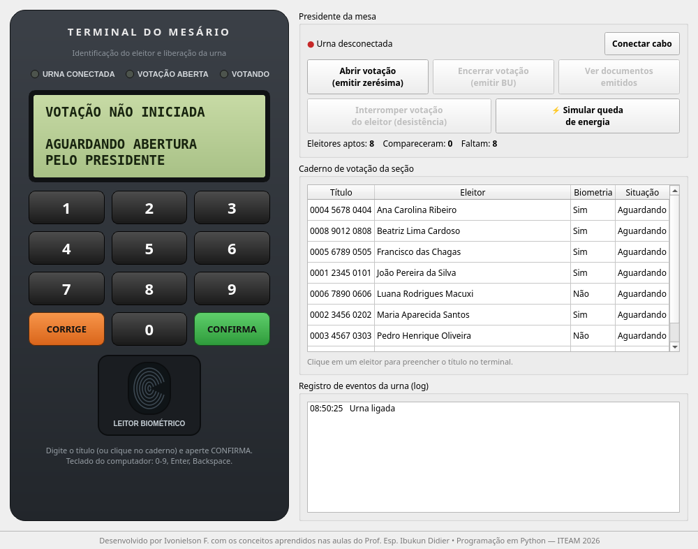</a><br><sub><b>Terminal do mesário.</b> Painel do presidente com o botão <i>Conectar cabo</i>, caderno de votação e log.</sub></td><td width="50%" valign="top"><a href="docs/img/urna_01_aguardando_conexao.png">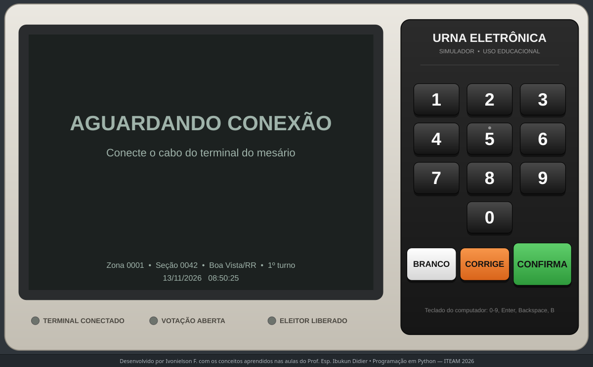</a><br><sub><b>Urna.</b> Tela escura até o cabo ser conectado.</sub></td></tr>
</table>

#### 2. Conectar o cabo

No painel *Presidente da mesa*, clique em **Conectar cabo**. O indicador fica verde, o LED "URNA CONECTADA" acende no terminal e "TERMINAL CONECTADO" acende na urna, que passa a mostrar "URNA PREPARADA".

<table>
<tr><td width="50%" valign="top"><a href="docs/img/terminal_02_conectado.png"></a><br><sub><b>Cabo conectado.</b> Agora o botão <i>Abrir votação</i> fica disponível.</sub></td><td width="50%" valign="top"><a href="docs/img/urna_02_preparada.png"></a><br><sub><b>Urna preparada.</b> Aguardando a abertura pelo presidente da mesa.</sub></td></tr>
</table>

#### 3. Abrir a votação e emitir a zerésima

Clique em **Abrir votação (emitir zerésima)**. O **visor do terminal** pede a senha do presidente da mesa: digite-a no teclado do terminal (aparece como `****`) e aperte **CONFIRMA** (ou **CORRIGE** para sair). A urna imprime a **zerésima** (todos os candidatos com 0 votos), salva em `boletins/` como `.txt` e `.pdf`, e passa a aguardar a liberação do eleitor. Senha errada mostra "SENHA INCORRETA / ABERTURA NÃO AUTORIZADA" e a votação continua fechada.

<table>
<tr><td width="50%" valign="top"><a href="docs/img/terminal_02b_senha_abertura.png">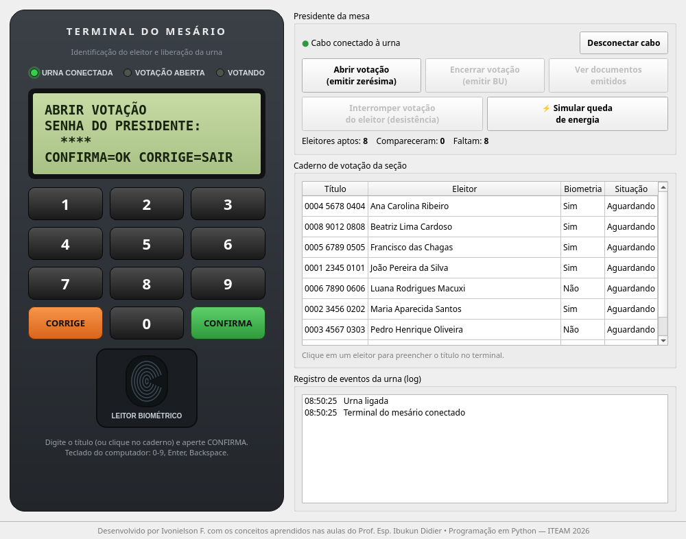</a><br><sub><b>Senha no visor.</b> Modo SENHA para abrir a votação: cada dígito aparece como *.</sub></td><td width="50%" valign="top"><a href="docs/img/dialogo_zeresima.png">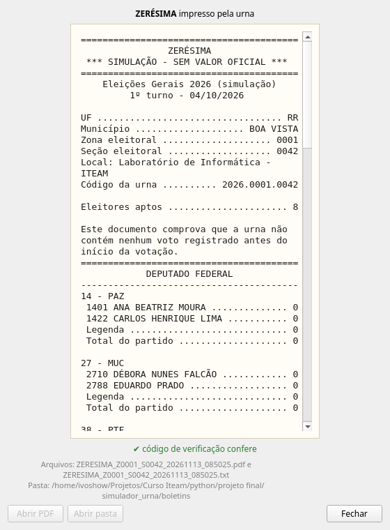</a><br><sub><b>Zerésima.</b> Prova de que a urna começa vazia. O aviso verde confirma o código de verificação.</sub></td></tr>
<tr><td width="50%" valign="top"><a href="docs/img/urna_03_aguardando_eleitor.png"></a><br><sub><b>Urna aguardando.</b> Votação aberta: LED "VOTAÇÃO ABERTA" aceso; relógio e seção no rodapé.</sub></td><td width="50%"></td></tr>
</table>

#### 4. Se o eleitor apertar teclas antes da liberação

A urna **bloqueia**: aparece a faixa vermelha "URNA BLOQUEADA — Aguarde a liberação pelo mesário", com um bipe de erro.

<table>
<tr><td width="50%" valign="top"><a href="docs/img/urna_04_bloqueada.png">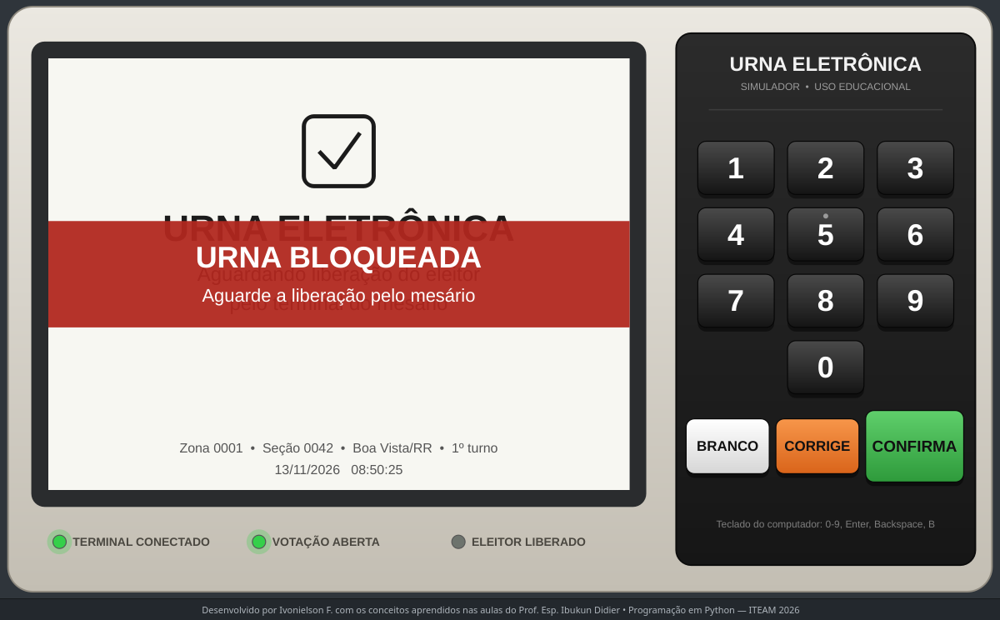</a><br><sub><b>Urna bloqueada.</b> Nenhuma tecla é aceita sem a liberação do mesário.</sub></td><td width="50%"></td></tr>
</table>

<a id="manual-liberar" name="manual-liberar"></a>

### 3.2 Identificar e liberar o eleitor (mesário)

#### 5. Digitar o título do eleitor

Digite os **12 dígitos** do título no teclado do terminal (ou do computador), ou **clique no eleitor** no caderno de votação. Aperte **CONFIRMA**.

<table>
<tr><td width="50%" valign="top"><a href="docs/img/terminal_05_titulo_digitado.png">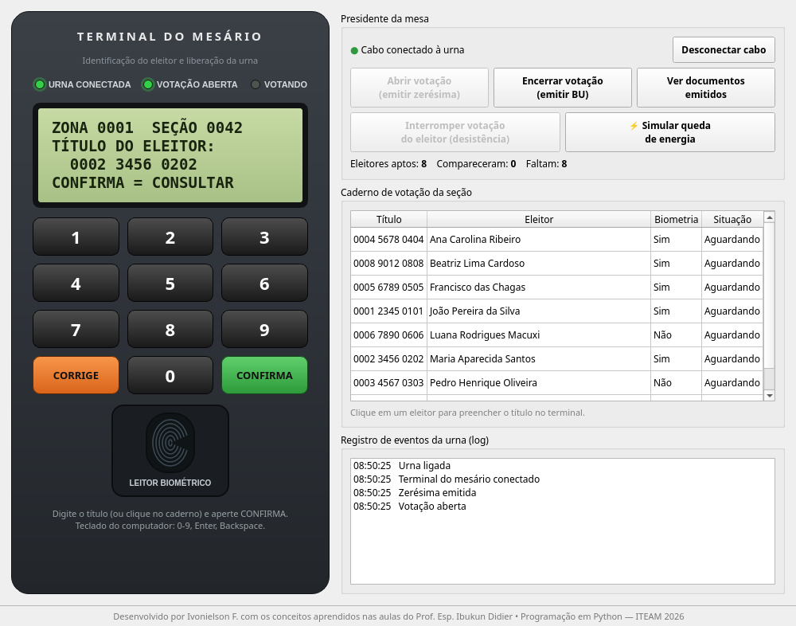</a><br><sub><b>Título digitado.</b> O display mostra o título em grupos de 4 dígitos.</sub></td><td width="50%"></td></tr>
</table>

#### 6. Conferir o nome

O terminal mostra o nome do eleitor. Confira com o documento e aperte **CONFIRMA** (ou **CORRIGE** para cancelar).

<table>
<tr><td width="50%" valign="top"><a href="docs/img/terminal_06_confirmar_eleitor.png">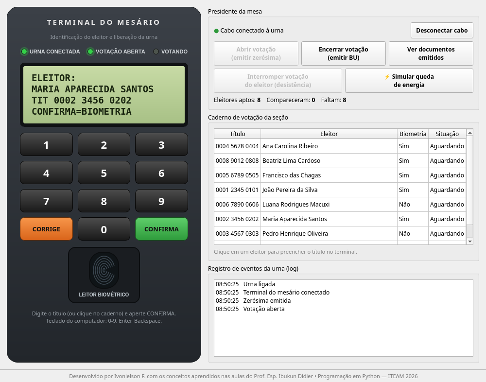</a><br><sub><b>Confirmar eleitor.</b> "CONFIRMA=BIOMETRIA": o próximo passo é a digital.</sub></td><td width="50%"></td></tr>
</table>

#### 7. Conferir a digital no leitor biométrico

O leitor **pisca em azul** ("TOQUE AQUI"). Clique nele para simular o dedo do eleitor; a leitura leva cerca de 1 segundo.

<table>
<tr><td width="50%" valign="top"><a href="docs/img/terminal_07_biometria.png">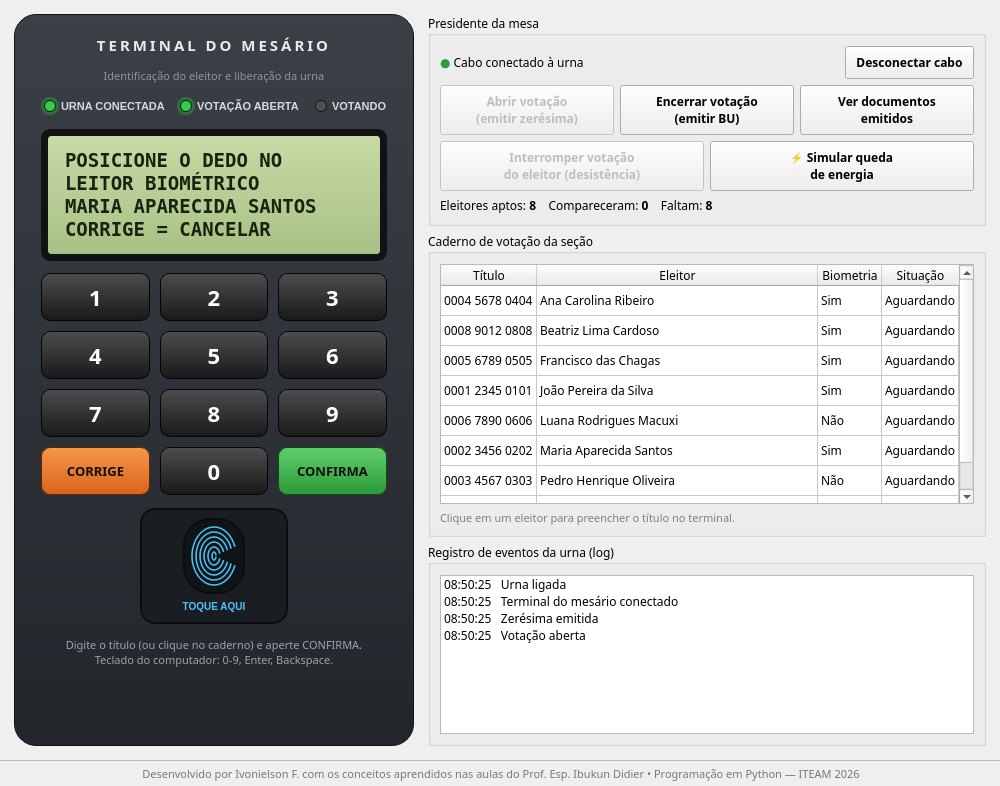</a><br><sub><b>Aguardando a digital.</b> Display: "POSICIONE O DEDO NO LEITOR BIOMÉTRICO".</sub></td><td width="50%" valign="top"><a href="docs/img/terminal_08_lendo_digital.png">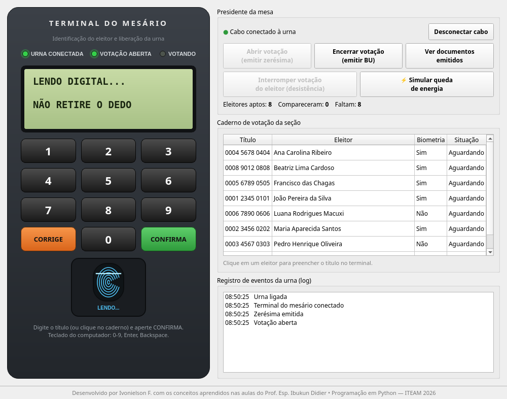</a><br><sub><b>Lendo a digital.</b> Linha de varredura no leitor; "NÃO RETIRE O DEDO".</sub></td></tr>
</table>

> [!NOTE]
> **Eleitor sem biometria cadastrada** (Pedro e Luana nos dados de exemplo): em vez do leitor, o visor pede ao mesário que **confira o documento com foto**. Conferido, aperte **CONFIRMA** e a urna é liberada.

<table>
<tr><td width="50%" valign="top"><a href="docs/img/terminal_11_sem_biometria.png"></a><br><sub><b>Sem biometria.</b> "CONFIRA DOC. COM FOTO" e "CONFIRMA=LIBERAR": o leitor biométrico não é usado.</sub></td><td width="50%"></td></tr>
</table>

#### 8. Urna liberada

Digital conferida: o terminal mostra "URNA LIBERADA / ELEITOR VOTANDO..." e o LED "ELEITOR LIBERADO" acende na urna, que abre a tela do primeiro cargo.

<table>
<tr><td width="50%" valign="top"><a href="docs/img/terminal_09_eleitor_votando.png">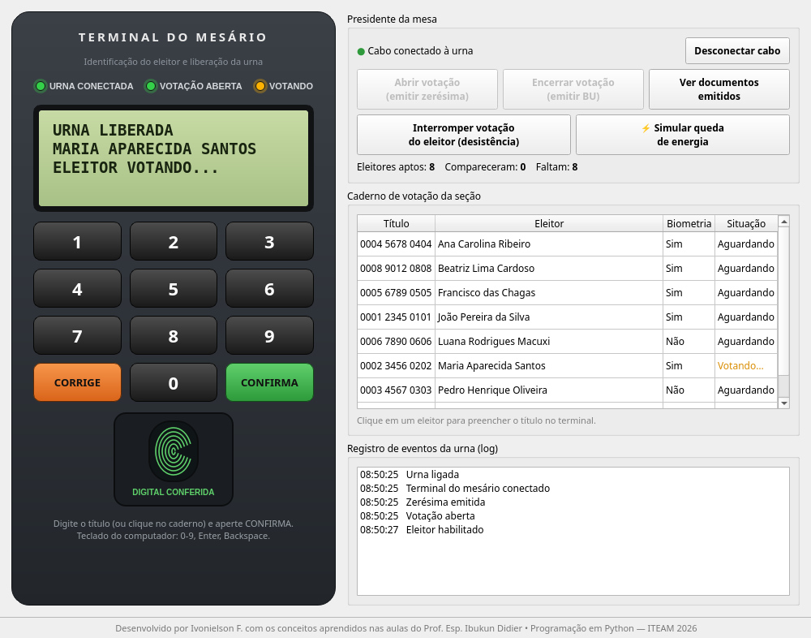</a><br><sub><b>Terminal.</b> No caderno, o eleitor aparece como "Votando…".</sub></td><td width="50%" valign="top"><a href="docs/img/urna_05_inicio_votacao.png">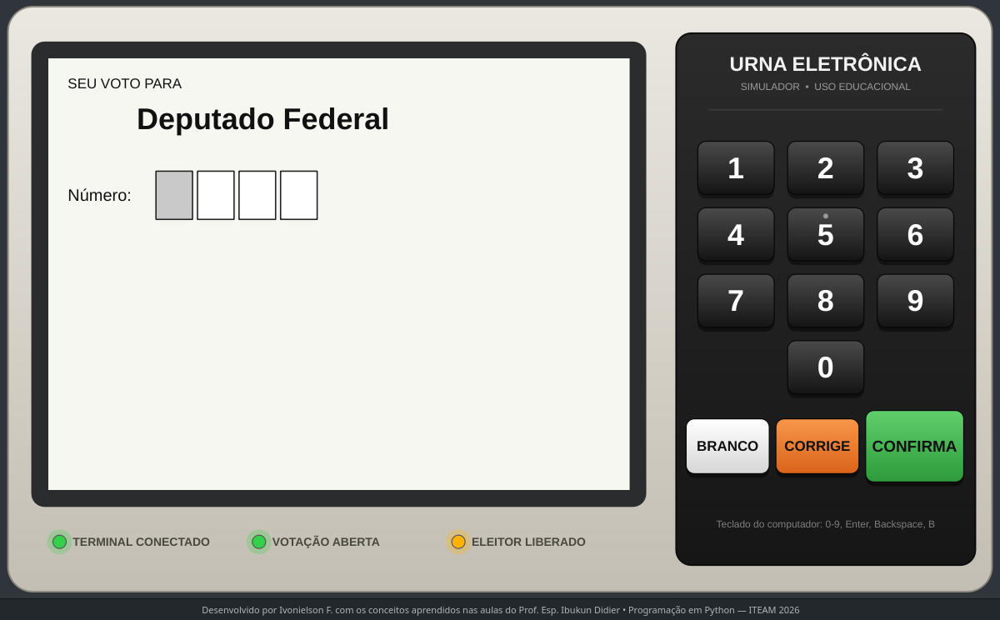</a><br><sub><b>Urna.</b> Primeiro cargo: Deputado Federal, com o cursor piscando na 1ª caixa.</sub></td></tr>
</table>

<a id="manual-votar" name="manual-votar"></a>

### 3.3 Votar (eleitor)

| Tecla da urna | Teclado do computador | O que faz |
|---|---|---|
| 0 a 9 | 0 a 9 | Digita o número do candidato (ou só os 2 do partido, para deputado) |
| **CONFIRMA** (verde) | Enter | Confirma o voto do cargo e passa para o próximo |
| **CORRIGE** (laranja) | Backspace | Apaga e reinicia o voto do cargo atual |
| **BRANCO** (branca) | B | Vota em branco (só com o campo vazio) |

<table>
<tr><td width="50%" valign="top"><a href="docs/img/urna_06_deputado_federal.png">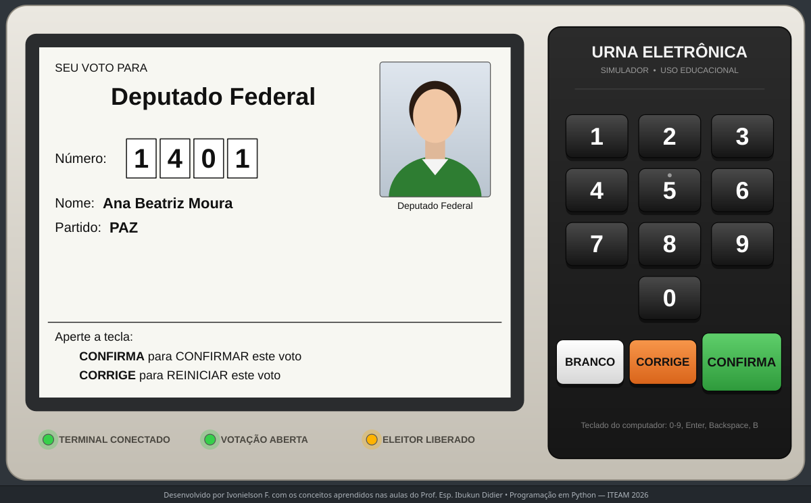</a><br><sub><b>Voto nominal.</b> Número completo de um candidato: aparecem nome, partido e foto. Aperte CONFIRMA.</sub></td><td width="50%" valign="top"><a href="docs/img/urna_07_legenda.png">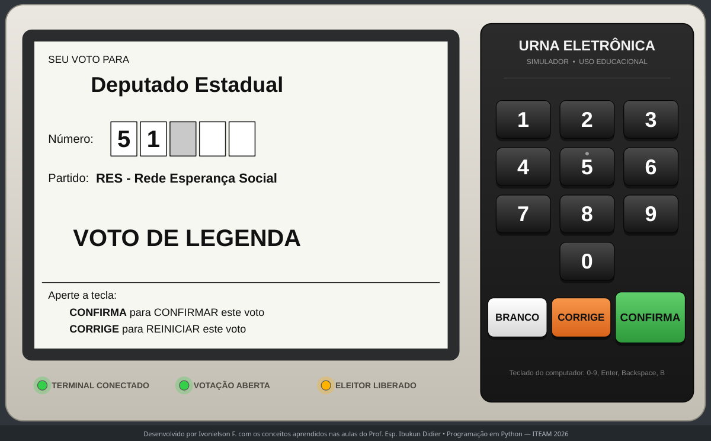</a><br><sub><b>Voto de legenda.</b> Para deputado, digitar só os 2 dígitos do partido e confirmar é votar no partido.</sub></td></tr>
<tr><td width="50%" valign="top"><a href="docs/img/urna_08_legenda_candidato_inexistente.png">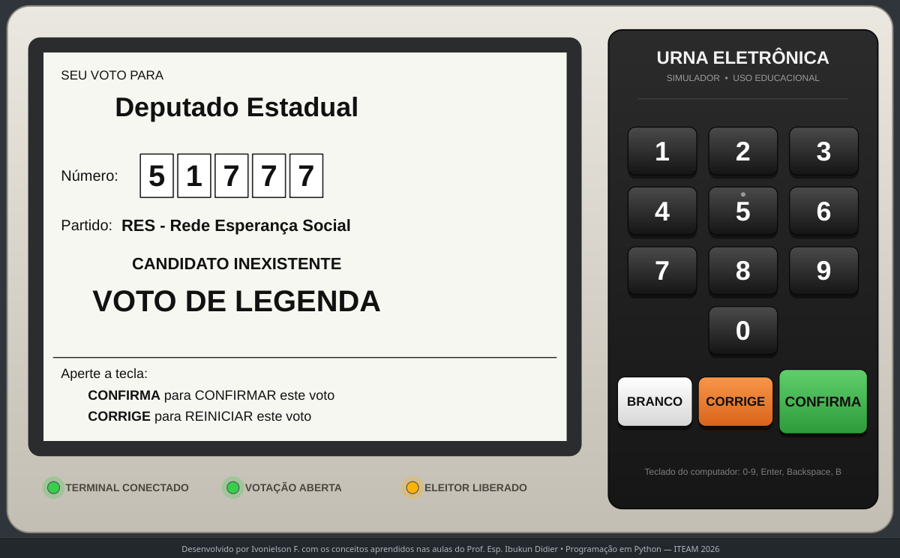</a><br><sub><b>Candidato inexistente.</b> Número completo que não existe, mas com partido válido, vira voto de legenda.</sub></td><td width="50%" valign="top"><a href="docs/img/urna_09_senador_1voto.png">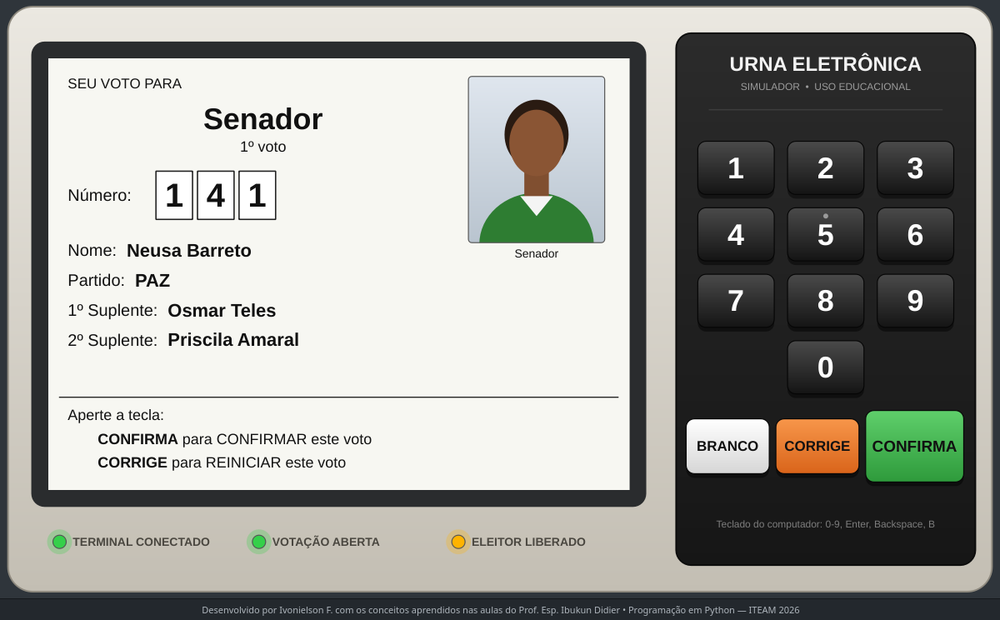</a><br><sub><b>Senador (1º voto).</b> Duas vagas: o eleitor vota duas vezes. Aparecem os suplentes.</sub></td></tr>
<tr><td width="50%" valign="top"><a href="docs/img/urna_10_senador_repetido.png">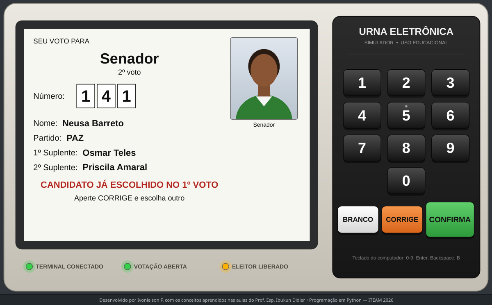</a><br><sub><b>Senador repetido.</b> No 2º voto, o mesmo candidato não é aceito. Aperte CORRIGE.</sub></td><td width="50%" valign="top"><a href="docs/img/urna_11_branco.png">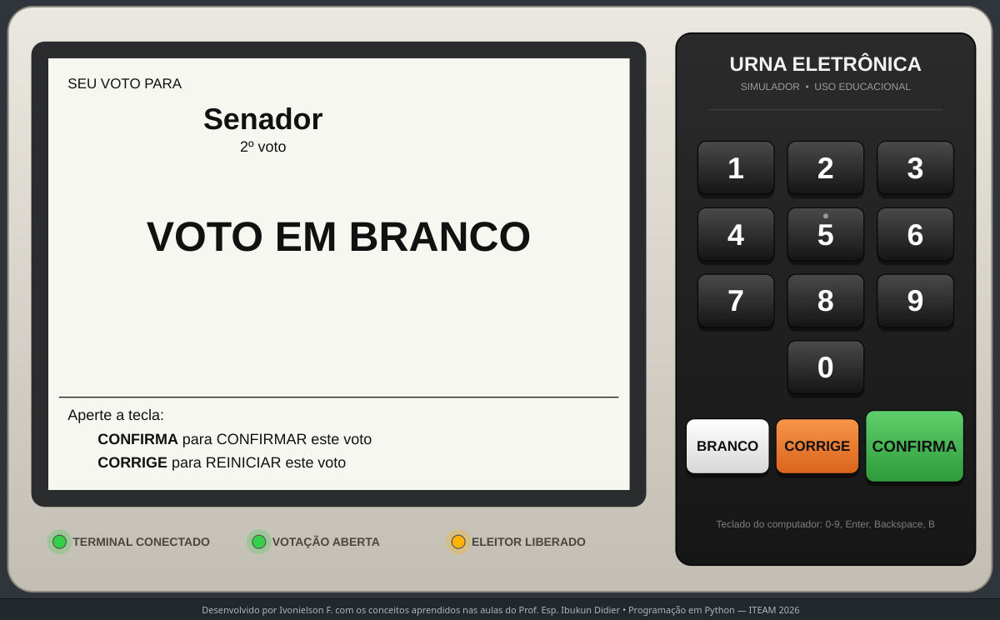</a><br><sub><b>Voto em branco.</b> Tecla BRANCO com o campo vazio; depois, CONFIRMA.</sub></td></tr>
<tr><td width="50%" valign="top"><a href="docs/img/urna_12_governador.png">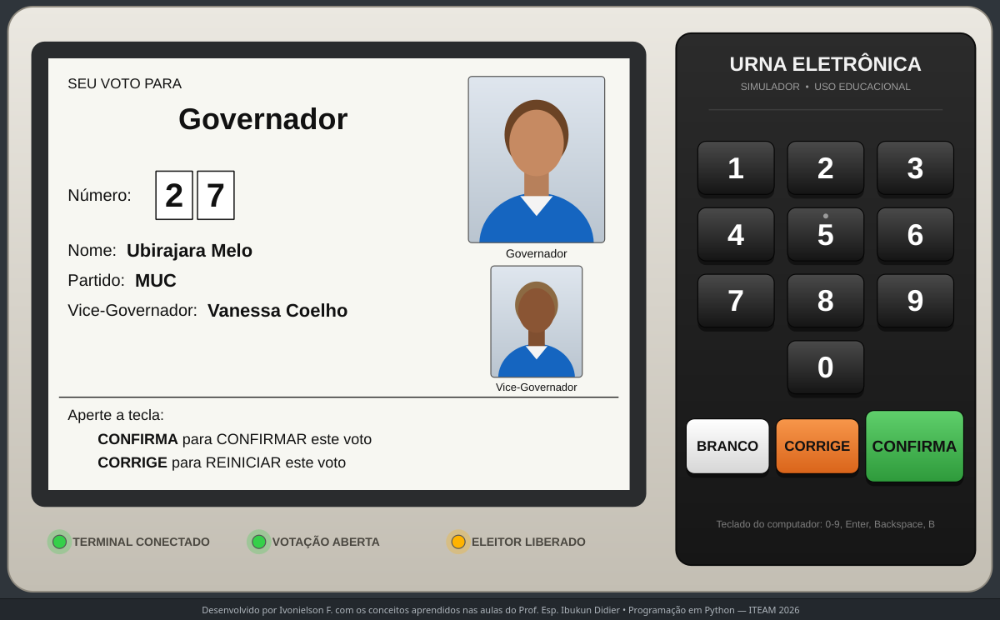</a><br><sub><b>Governador.</b> Cargos com vice mostram também a foto do vice.</sub></td><td width="50%" valign="top"><a href="docs/img/urna_13_nulo.png">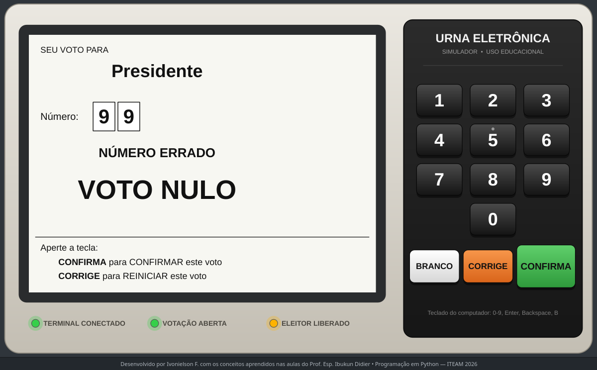</a><br><sub><b>Voto nulo.</b> Número que não existe: "NÚMERO ERRADO" e "VOTO NULO" piscando. Pode confirmar ou corrigir.</sub></td></tr>
<tr><td width="50%" valign="top"><a href="docs/img/urna_14_fim.png">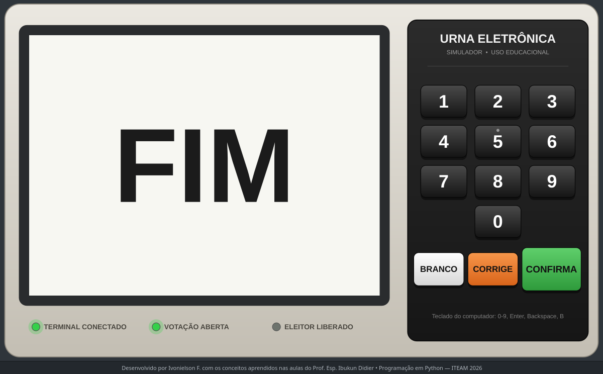</a><br><sub><b>FIM.</b> Depois do último cargo (Presidente) aparece FIM com o bipe característico.</sub></td><td width="50%" valign="top"><a href="docs/img/terminal_10_voto_concluido.png">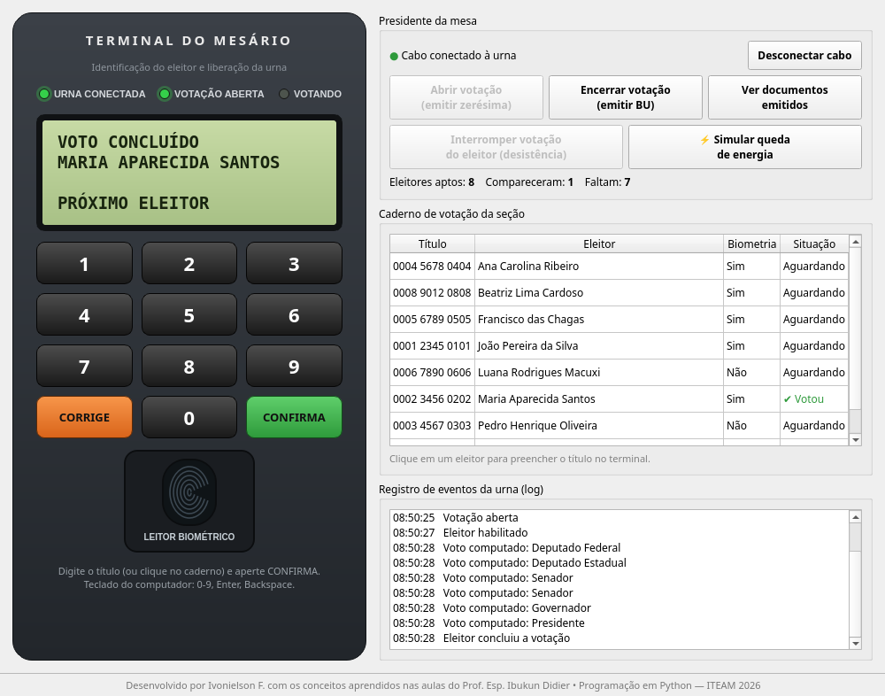</a><br><sub><b>Voto concluído.</b> O terminal avisa e o caderno marca "✔ Votou". Pronto para o próximo eleitor.</sub></td></tr>
</table>

<a id="manual-bloqueios" name="manual-bloqueios"></a>

### 3.4 Mensagens de bloqueio no terminal

Quando um eleitor não pode ser liberado, o display mostra o motivo com um bipe de erro e volta à tela do título depois de alguns segundos (ou ao apertar CORRIGE).

<table>
<tr><td width="50%" valign="top"><a href="docs/img/terminal_12_ja_votou.png"></a><br><sub><b>Eleitor já votou.</b> Impede o voto duplo.</sub></td><td width="50%" valign="top"><a href="docs/img/terminal_13_urna_desconectada.png"></a><br><sub><b>Urna não conectada.</b> Cabo desconectado: nenhum eleitor é liberado.</sub></td></tr>
<tr><td width="50%" valign="top"><a href="docs/img/urna_15_terminal_desconectado.png">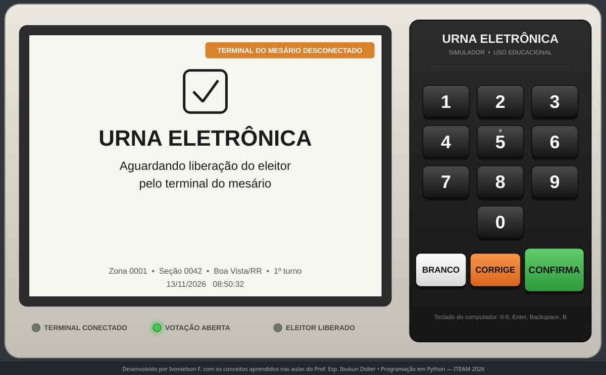</a><br><sub><b>Aviso na urna.</b> A urna mostra a faixa "TERMINAL DO MESÁRIO DESCONECTADO".</sub></td><td width="50%" valign="top"><a href="docs/img/terminal_14_urna_ocupada.png">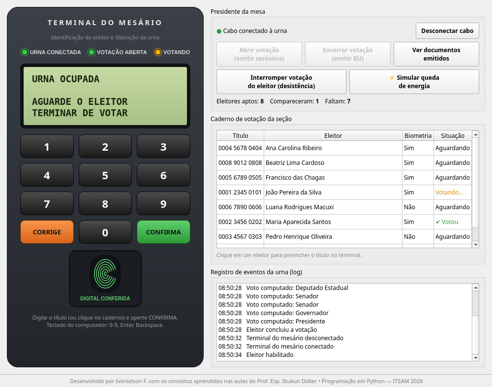</a><br><sub><b>Urna ocupada.</b> Enquanto um eleitor vota, nenhum outro pode ser liberado.</sub></td></tr>
</table>

<a id="manual-desistencia" name="manual-desistencia"></a>

### 3.5 Eleitor desistiu: interromper a votação

Se o eleitor **desistir ou sair da cabine** sem terminar, o presidente da mesa clica em **Interromper votação do eleitor (desistência)** — o botão só fica ativo com alguém votando — e digita a senha no visor. A urna aplica a regra:

- **Nenhum voto confirmado:** a votação é **suspensa**; o eleitor não consta como votante e pode voltar depois.
- **Pelo menos um voto confirmado:** os confirmados valem, os cargos que faltavam viram **votos nulos** e o eleitor consta como **votou**.

<table>
<tr><td width="50%" valign="top"><a href="docs/img/terminal_18_senha_interromper.png">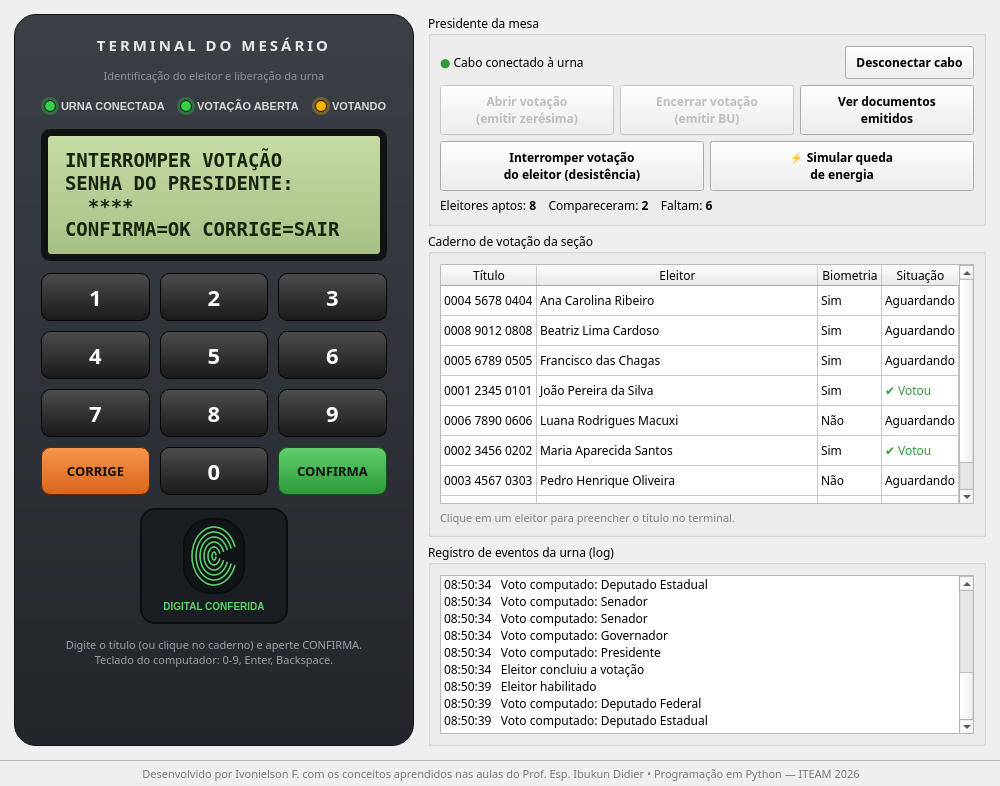</a><br><sub><b>Senha para interromper.</b> Mesmo modo SENHA da abertura e do encerramento.</sub></td><td width="50%" valign="top"><a href="docs/img/terminal_19_interrompida.png">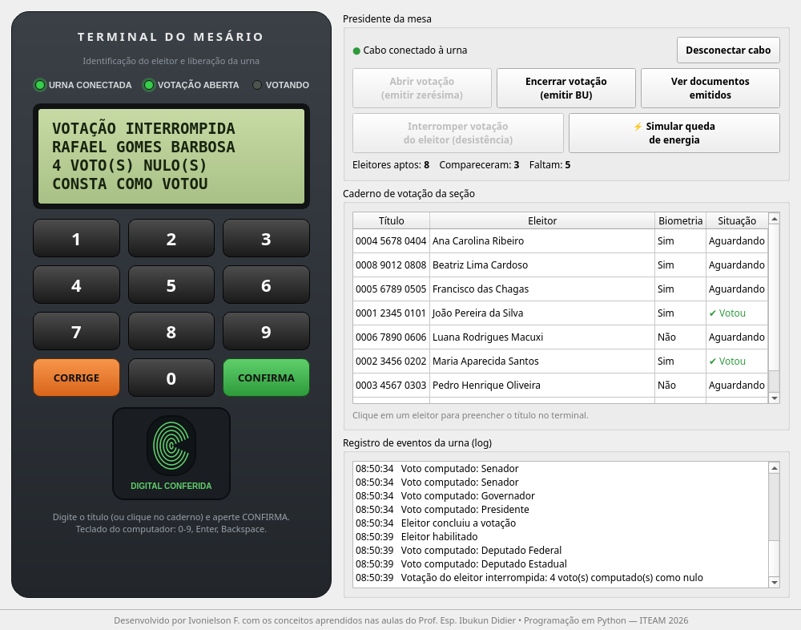</a><br><sub><b>Votação interrompida.</b> Rafael confirmou 2 votos: os 4 restantes viraram nulos e ele "CONSTA COMO VOTOU".</sub></td></tr>
<tr><td width="50%" valign="top"><a href="docs/img/urna_17_interrompida.png">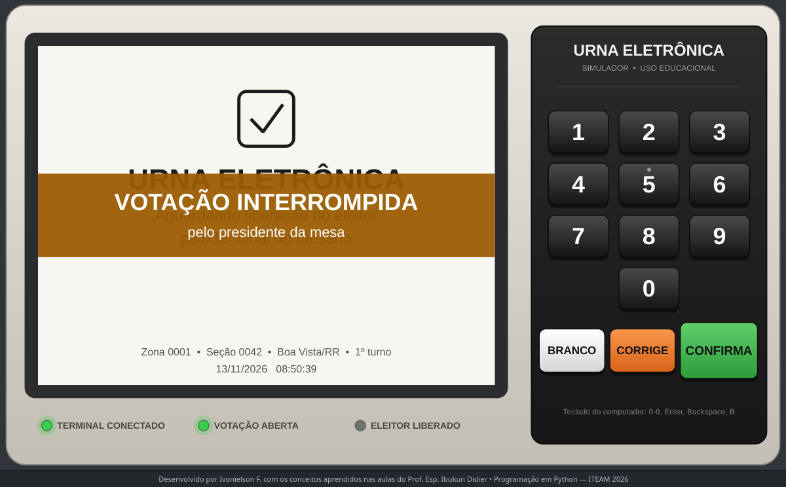</a><br><sub><b>Na urna.</b> Faixa "VOTAÇÃO INTERROMPIDA pelo presidente da mesa".</sub></td><td width="50%"></td></tr>
</table>

<a id="manual-energia" name="manual-energia"></a>

### 3.6 Queda de energia

A urna grava seu estado na **memória interna** (arquivo em `memoria/`) a cada evento. Clique em **⚡ Simular queda de energia**: as duas telas apagam por alguns segundos e o programa **joga fora todos os objetos**. Quando a energia volta, tudo é recriado a partir do JSON da eleição e da memória: **quem já votou continua marcado no caderno**, os votos continuam contados e o log, a zerésima e o cabo são recuperados. Se alguém estava votando, vale a mesma regra da interrupção.

<table>
<tr><td width="50%" valign="top"><a href="docs/img/urna_18_sem_energia.png">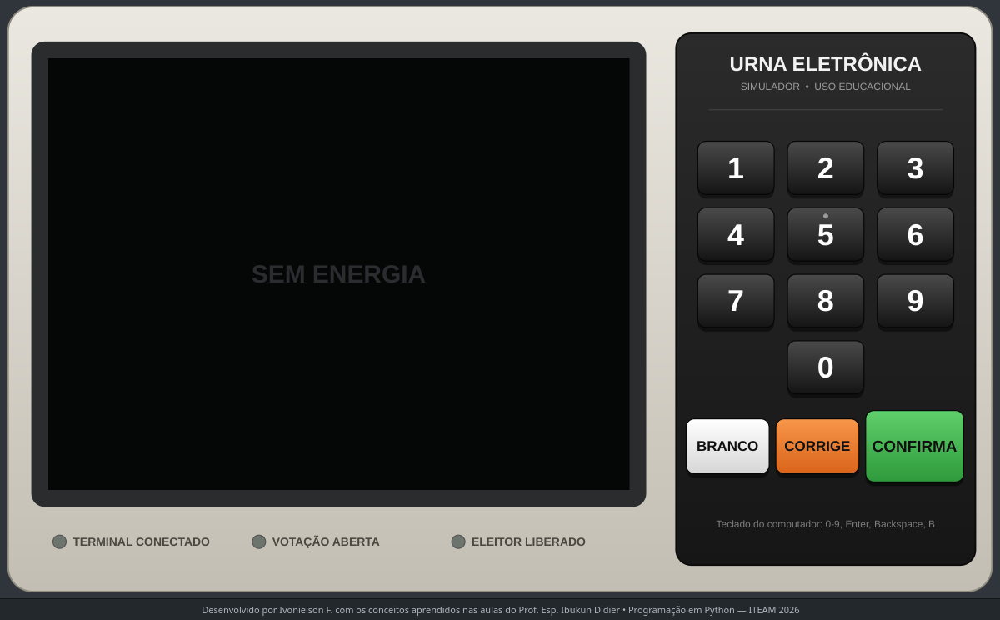</a><br><sub><b>Sem energia.</b> Tela apagada, LEDs desligados e teclado sem resposta.</sub></td><td width="50%" valign="top"><a href="docs/img/terminal_20_sem_energia.png">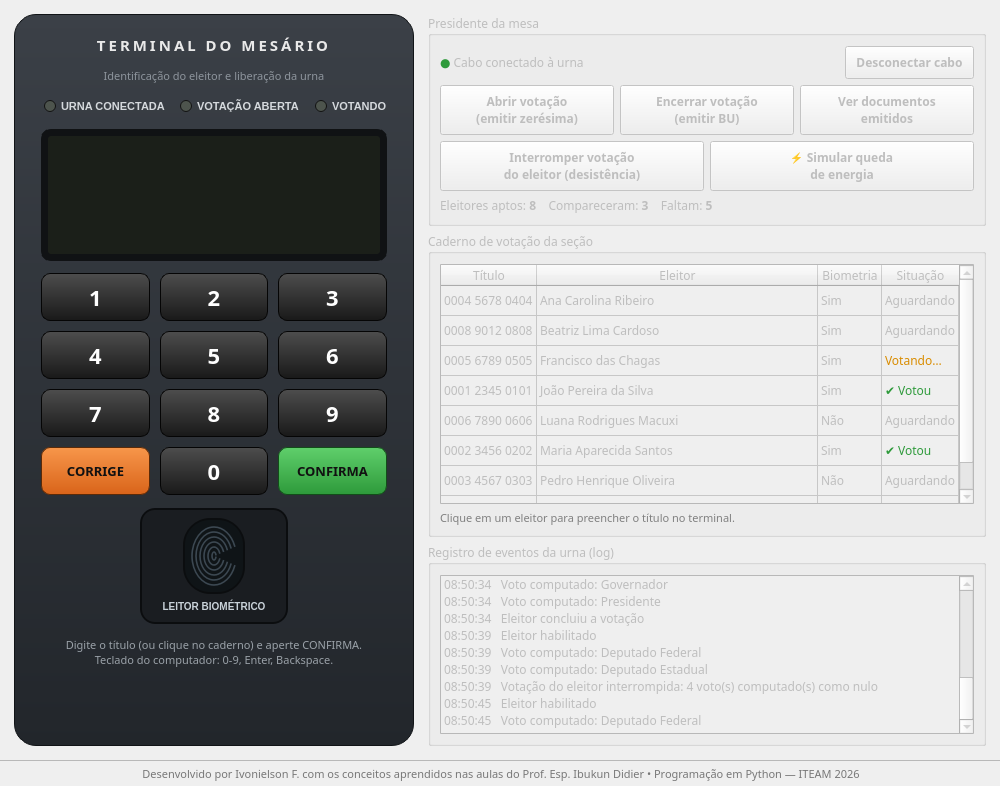</a><br><sub><b>Terminal sem energia.</b> Display e controles desligados.</sub></td></tr>
<tr><td width="50%" valign="top"><a href="docs/img/urna_19_energia_restabelecida.png">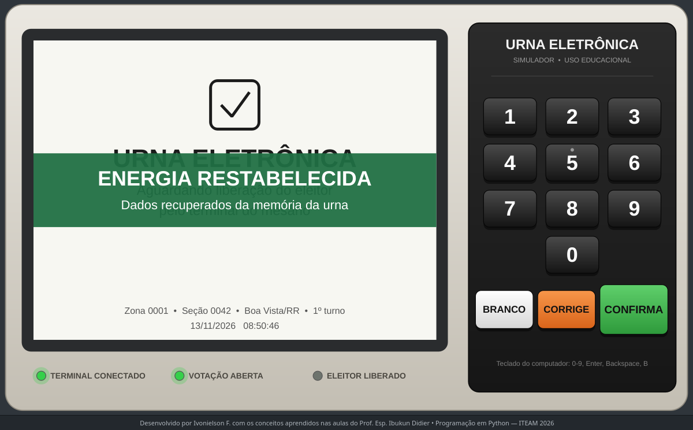</a><br><sub><b>Energia restabelecida.</b> "Dados recuperados da memória da urna".</sub></td><td width="50%" valign="top"><a href="docs/img/terminal_21_energia_restabelecida.png">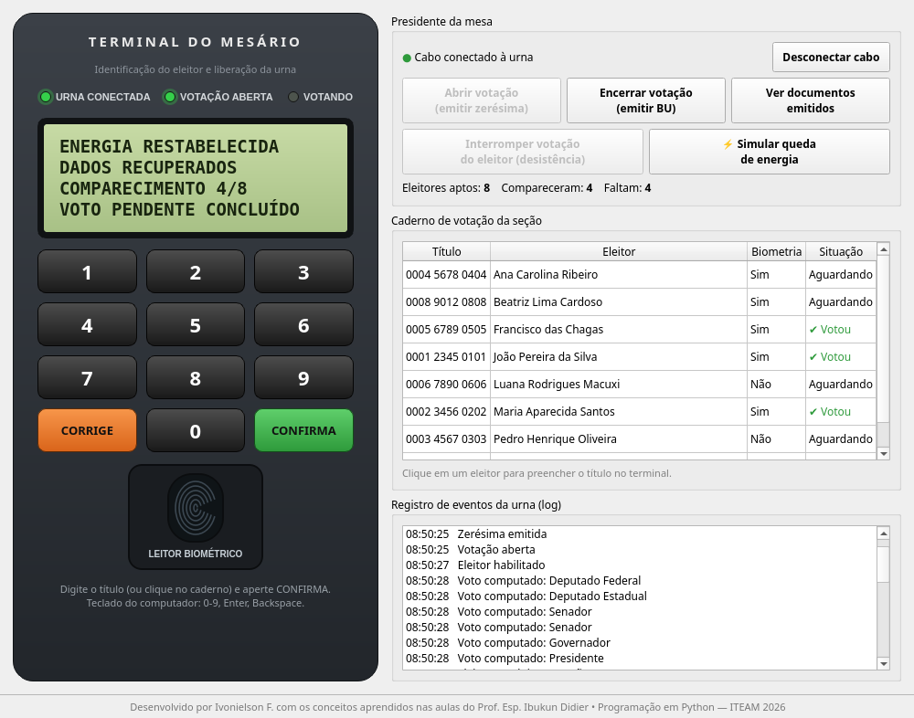</a><br><sub><b>Dados recuperados.</b> Comparecimento mantido (4/8) e "VOTO PENDENTE CONCLUÍDO": Francisco tinha confirmado 1 voto.</sub></td></tr>
</table>

Ao abrir o programa de novo com uma votação gravada, ele pergunta se deve **continuar** essa votação ou começar uma **nova**. Para começar do zero direto: `python main.py --nova`.

<a id="manual-encerrar" name="manual-encerrar"></a>

### 3.7 Encerrar a votação e emitir o Boletim de Urna

#### 9. Encerrar com a senha do presidente

Com a urna livre (ninguém votando), clique em **Encerrar votação (emitir BU)**. O **visor do terminal** pede a senha do presidente da mesa: digite-a no teclado do terminal (ou do computador). Ela aparece como `****`. Aperte **CONFIRMA** para encerrar ou **CORRIGE** para sair sem encerrar. Senha errada mostra "SENHA INCORRETA" e a tentativa fica registrada no log. A senha de exemplo é `1234`.

<table>
<tr><td width="50%" valign="top"><a href="docs/img/terminal_16_senha_presidente.png">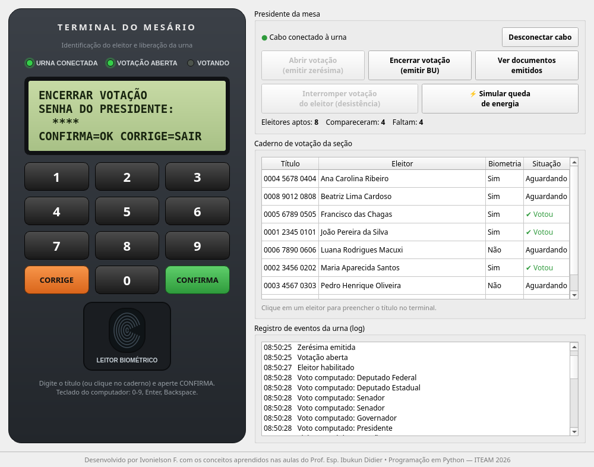</a><br><sub><b>Senha no visor.</b> Modo SENHA do terminal: cada dígito aparece como *.</sub></td><td width="50%" valign="top"><a href="docs/img/terminal_17_senha_incorreta.png">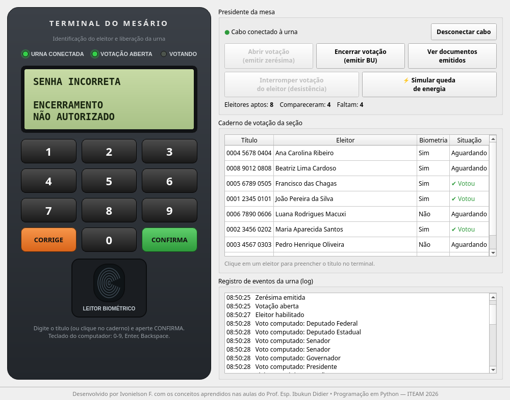</a><br><sub><b>Senha incorreta.</b> O encerramento não é autorizado e a tentativa vai para o log.</sub></td></tr>
<tr><td width="50%" valign="top"><a href="docs/img/terminal_15_encerrada.png">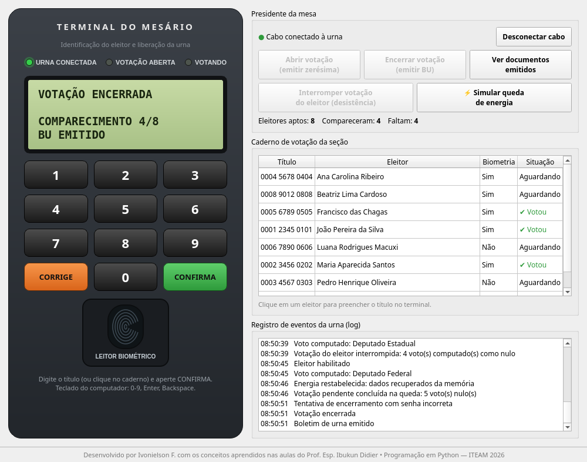</a><br><sub><b>Terminal encerrado.</b> Display: "VOTAÇÃO ENCERRADA / BU EMITIDO". Log completo da urna.</sub></td><td width="50%" valign="top"><a href="docs/img/urna_16_encerrada.png">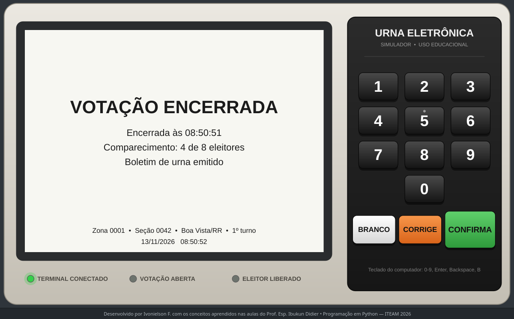</a><br><sub><b>Urna encerrada.</b> Mostra o horário e o comparecimento.</sub></td></tr>
</table>

#### 10. Conferir o Boletim de Urna

O BU aparece como uma bobina impressa e é salvo em `boletins/` (`.txt` e `.pdf` de 80 mm). Use **Abrir PDF** ou **Abrir pasta**. Depois, o botão **Ver documentos emitidos** mostra de novo a zerésima e o BU.

<table>
<tr><td width="50%" valign="top"><a href="docs/img/dialogo_boletim.png">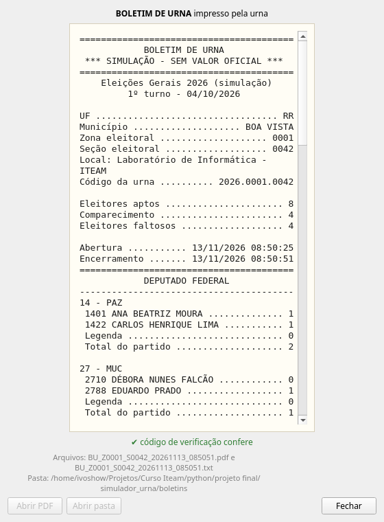</a><br><sub><b>Janela do BU.</b> "✔ código de verificação confere": o documento não foi alterado.</sub></td><td width="50%" valign="top"><a href="docs/img/boletim_pdf.png">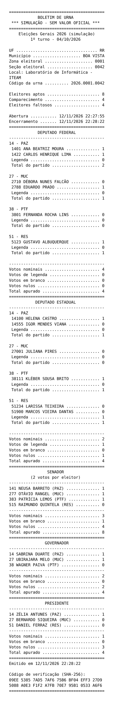</a><br><sub><b>PDF do BU.</b> Formato de bobina de impressora térmica (role para ver tudo).</sub></td></tr>
</table>

<a id="manual-2turno" name="manual-2turno"></a>

### 3.8 Segundo turno (só Presidente)

Para simular o 2º turno, abra o programa com o arquivo da eleição do 2º turno:

```bash
python main.py --eleicao dados/eleicao_2turno.json
```

O fluxo é o mesmo do 1º turno (cabo, abertura com senha, liberação, encerramento), mas a urna tem um **único cargo**: o eleitor digita o número, aperta CONFIRMA uma vez e já aparece **FIM**. O turno aparece no rodapé da tela da urna e no título das janelas, e a memória do 2º turno é **separada** da do 1º: quem votou no 1º turno aparece como "Aguardando" no caderno do 2º.

<table>
<tr><td width="50%" valign="top"><a href="docs/img/urna_20_segundo_turno_espera.png">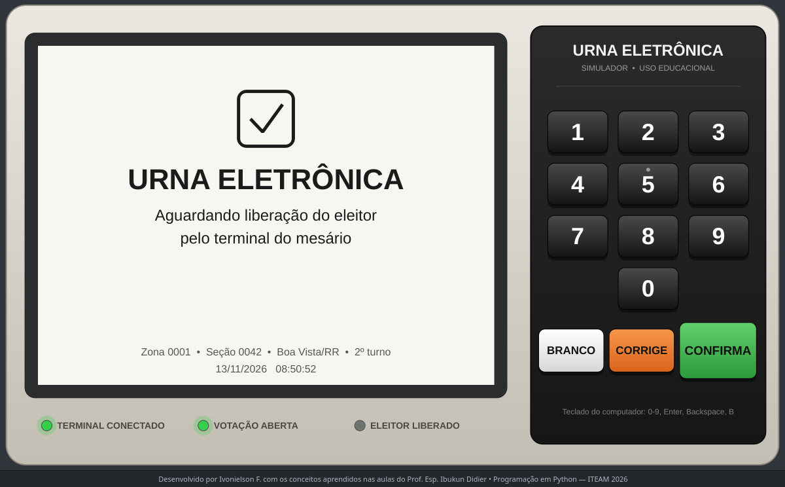</a><br><sub><b>Urna no 2º turno.</b> Rodapé: "… Boa Vista/RR • 2º turno".</sub></td><td width="50%" valign="top"><a href="docs/img/urna_21_segundo_turno_presidente.png">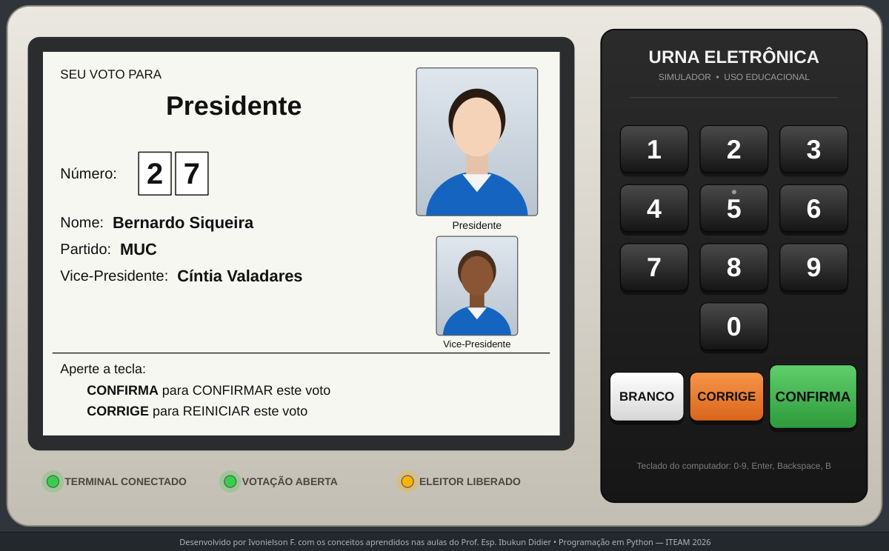</a><br><sub><b>Voto para Presidente.</b> Único cargo do 2º turno, com os dois candidatos mais votados no 1º.</sub></td></tr>
</table>

<a id="arquitetura" name="arquitetura"></a>

## 4. Arquitetura

O código é dividido em **duas camadas** que não se misturam:

#### 📦 `modelo/` — as regras

Python puro. Sabe o que é um eleitor, um voto, uma urna aberta ou encerrada. **Não importa nada do PySide6**: não sabe desenhar, não tem `print` nem `input`.

#### 🎨 `interface/` — o visual

PySide6 (Qt). Só desenha e repassa as teclas para o modelo. Não decide se um voto é nulo ou se o eleitor pode votar: pergunta ao modelo.

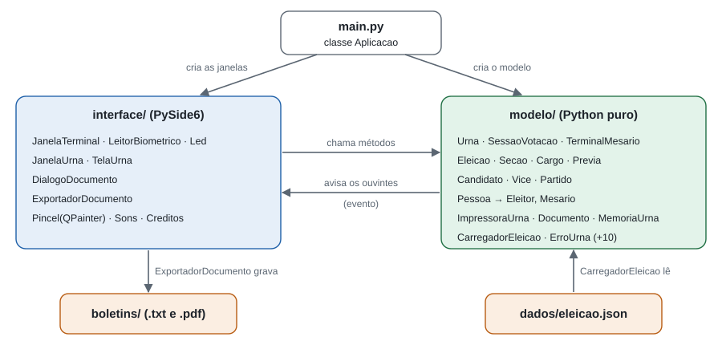

*A interface conhece o modelo; o modelo não conhece a interface (só avisa "ouvintes").*

### Estrutura de pastas

```text
simulador_urna/
├── main.py                   Aplicacao: cria o modelo, as duas janelas e liga uma à outra
├── requirements.txt          PySide6
├── dados/eleicao.json        1º turno: seção, partidos, cargos, candidatos, eleitores e senha
├── dados/eleicao_2turno.json 2º turno: só Presidente, com os dois candidatos
├── memoria/                  memória da urna (criada ao rodar; sobrevive à queda de energia)
├── modelo/                   REGRAS (Python puro)
│   ├── erros.py              ErroUrna e 10 exceções específicas
│   ├── partido.py            Partido
│   ├── candidato.py          Candidato e Vice
│   ├── cargo.py              Cargo, Previa e TipoVoto
│   ├── pessoas.py            Pessoa → Eleitor, Mesario
│   ├── eleicao.py            Eleicao e Secao
│   ├── urna.py               Urna, SessaoVotacao, EstadoUrna e ResultadoInterrupcao
│   ├── memoria.py            MemoriaUrna (memória interna gravada em disco)
│   ├── terminal.py           TerminalMesario
│   ├── boletim.py            ImpressoraUrna e Documento
│   └── carregador.py         CarregadorEleicao
├── interface/                VISUAL (PySide6)
│   ├── janela_urna.py        TelaUrna e JanelaUrna
│   ├── janela_terminal.py    JanelaTerminal, LeitorBiometrico, Led e Modo
│   ├── dialogo_documento.py  DialogoDocumento
│   ├── exportar.py           ExportadorDocumento
│   ├── desenho.py            Pincel (herda de QPainter)
│   ├── creditos.py           Creditos (mensagem do rodapé das janelas)
│   └── sons.py               Sons
├── testes/                   19 testes: regras (test_modelo) e queda de energia (test_memoria)
└── docs/index.html           esta documentação
```

> [!NOTE]
> **Por que separar?** (1) Dá para **testar a urna inteira sem abrir janelas**; (2) dá para trocar a interface (texto, web, outra biblioteca) sem mexer nas regras; (3) cada classe tem **uma responsabilidade** — critério "Clareza" da rubrica da Aula 10.

<a id="fluxo" name="fluxo"></a>

## 5. Fluxo de uma votação

Do título digitado pelo mesário até o voto contado — quem chama quem:

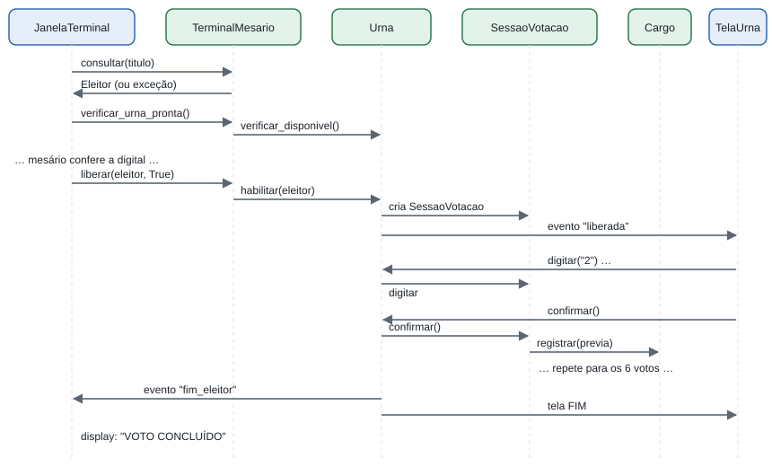

*Verde = modelo; azul = interface. Cada voto vai direto para a contagem do Cargo — sem o nome do eleitor.*

<a id="estados" name="estados"></a>

## 6. Estados da urna

A urna é uma **máquina de estados** (`EstadoUrna`, um `Enum`). Cada método confere o estado atual antes de agir. Além do estado, existe a **conexão** (`conectada`), que é independente.

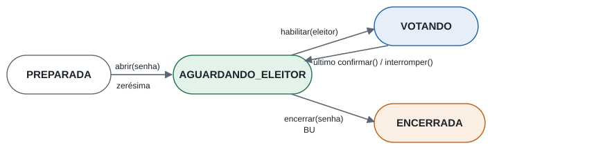

*Só dá para encerrar em AGUARDANDO\_ELEITOR: com alguém votando, `encerrar()` lança `UrnaOcupada`.*

| Estado | Tela da urna | Teclas da urna | Liberar eleitor |
|---|---|---|---|
| `PREPARADA` | "AGUARDANDO CONEXÃO" ou "URNA PREPARADA" | UrnaBloqueada | VotacaoNaoIniciada |
| `AGUARDANDO_ELEITOR` | "Aguardando liberação do eleitor" | UrnaBloqueada (faixa vermelha) | ✔ (se conectada) |
| `VOTANDO` | "SEU VOTO PARA …" | ✔ | UrnaOcupada |
| `ENCERRADA` | "VOTAÇÃO ENCERRADA" | UrnaBloqueada | VotacaoEncerrada |

<a id="poo" name="poo"></a>

## 7. Conceitos de POO aplicados

Esta seção explica **por que** o código foi escrito assim, com exemplos tirados do próprio projeto.

<a id="classes" name="classes"></a>

### 7.1 Classe e objeto

A **classe** é o molde; o **objeto** é uma instância com seus próprios valores. `Eleitor` é a classe; o João e a Maria são dois objetos diferentes, cada um com o seu título e o seu `votou`. O `__init__` (construtor) preenche e **valida** os atributos: um objeto nunca nasce inválido.

```python
class Eleitor(Pessoa):
    def __init__(self, titulo, nome, possui_biometria=True):
        super().__init__(nome)
        titulo = str(titulo)
        if len(titulo) != self.DIGITOS_TITULO or not titulo.isdigit():
            raise ValueError(f"Título inválido: {titulo!r} (use 12 dígitos).")
        self.__titulo = titulo
        self.__biometria = bool(possui_biometria)
        self.__votou = False
```

<a id="encapsulamento" name="encapsulamento"></a>

### 7.2 Encapsulamento: público, `_protegido` e `__privado`

Encapsular é **esconder os dados internos** e só deixar mexer neles por métodos que aplicam as regras. Python usa uma convenção de nomes com sublinhado:

| Forma | Significado | Exemplo no projeto |
|---|---|---|
| `público` `nome` | Pode ser usado por qualquer código. | `urna.estado`, `terminal.liberar()` |
| `protegido` `_nome` | **Convenção**: "uso interno, não mexa de fora". O Python não impede nada. | `Urna._notificar()`, `TerminalMesario._urna()`, quase todo o estado interno das janelas (`_modo`, `_titulo`) |
| `privado` `__nome` | O Python **renomeia** o atributo (*name mangling*) para `_Classe__nome`. Acesso por fora com o nome original falha. | `Eleicao.__turno`, `Candidato.__votos`, `Mesario.__senha`, `Urna.__estado` |

#### O que o Python faz com `__turno` (name mangling)

Quando a classe `Eleicao` escreve `self.__turno = turno`, o Python guarda o atributo com o nome **`_Eleicao__turno`**. Resultado real, executado no projeto:

```python
>>> el.turno                    # pela @property: funciona
1
>>> el.__turno
AttributeError: 'Eleicao' object has no attribute '__turno'
>>> el.turno = 2                # a property não tem setter
AttributeError: property 'turno' of 'Eleicao' object has no setter
>>> list(vars(el))[:4]          # os nomes verdadeiros dentro do objeto
['_Eleicao__descricao', '_Eleicao__turno', '_Eleicao__data', '_Eleicao__secao']
>>> el._Eleicao__turno          # dá para "furar", mas só de propósito
1
```

> [!WARNING]
> **Importante:** `__` *não é segurança* — é **proteção contra acidentes**. Quem escreve `el._Eleicao__turno` sabe que está quebrando o encapsulamento. Outra pegadinha real: `el.__turno = 99` fora da classe **não altera o turno**; cria um atributo novo chamado literalmente `__turno` (testamos: depois disso, `el.turno` continua `1`).

#### Por que usamos `__` (e não só `_`) no modelo

- **Os dados do modelo são as regras da eleição.** O turno, os votos de um candidato, a senha do mesário e o estado da urna não podem ser alterados por engano. Com `__`, um `candidato.votos = 1000` ou `candidato.__votos = 1000` simplesmente não muda a contagem.
- **Evita colisão de nomes na herança.** `Pessoa` guarda `self.__nome` e `Eleitor` guarda `self.__titulo`. Os nomes reais ficam separados por classe: `['_Pessoa__nome', '_Eleitor__titulo', '_Eleitor__biometria', '_Eleitor__votou']`. Por isso o `Eleitor` não acessa `self.__nome` (que viraria `_Eleitor__nome`) — ele usa a property `self.nome` herdada de `Pessoa`.
- **Métodos privados também.** `ImpressoraUrna.__cabecalho()`, `CarregadorEleicao.__criar_cargo()`, `Urna.__restaurar()` e `Aplicacao.__posicionar()` são detalhes de implementação: quem usa a classe só precisa de `emitir_boletim()`, `carregar()`, `liberar()` e `executar()`.

#### E por que a interface usa `_`?

Nas janelas (`JanelaTerminal._modo`, `TelaUrna._pressionada`…) o estado é apenas *visual*: se alguém mexer, no máximo a tela se desenha errado — a eleição continua correta, porque as regras estão no modelo. A convenção `_` é suficiente e deixa o código mais simples. **A proteção forte (`__`) foi colocada onde ela importa: nas regras.**

#### Atributos que ficaram públicos de propósito

- `Vice.titulo` e `Vice.nome`: o vice é só um "rótulo" exibido na tela, sem regra para proteger.
- `Previa`, `Secao` e `Documento`: são `@dataclass(frozen=True)` — **imutáveis**. Qualquer tentativa de alterar gera `FrozenInstanceError`, então não precisam de `__`.
- Nas janelas, `self.urna`, `self.terminal`, `self.sons`: são as dependências que a janela recebe.

<a id="property" name="property"></a>

### 7.3 `@property`: ler como atributo, controlar como método

O decorador `@property` transforma um método em algo que se **lê como atributo** (`eleicao.turno`, sem parênteses). Usamos de três formas:

#### a) Leitura sem escrita (somente leitura)

```python
class Eleicao:
    def __init__(self, descricao, turno, ...):
        self.__turno = turno          # guardado escondido

    @property
    def turno(self):                # exposto só para leitura
        return self.__turno
```

Como não existe `@turno.setter`, ninguém consegue trocar o turno depois de criado (`property 'turno' of 'Eleicao' object has no setter`). Isso vale para `Candidato.votos`: a **única** forma de somar um voto é `receber_voto()`.

#### b) Valores calculados na hora

Algumas properties não guardam nada — calculam a partir de outros dados, então nunca ficam desatualizadas:

| Property | Cálculo |
|---|---|
| `Cargo.total` | `validos + brancos + nulos` |
| `Cargo.validos` | `nominais + legenda_total` |
| `Eleicao.comparecimento` | quantos eleitores têm `votou == True` |
| `Eleitor.titulo_formatado` | `"0001 2345 0101"` a partir de `__titulo` |
| `TerminalMesario.conectado` | tem urna *e* a urna está conectada |
| `SessaoVotacao.previa` | interpreta o número digitado no cargo atual |

#### c) Devolver cópias, protegendo coleções internas

`Eleicao.eleitores` devolve uma **lista nova** (ordenada), `Eleicao.partidos` devolve um **dict copiado** e `Urna.log` devolve uma **tupla**. Teste real: apagar a lista recebida não apaga ninguém da eleição.

```python
>>> lista = el.eleitores
>>> lista.clear()
>>> el.aptos
8           # o dicionário interno __eleitores continua intacto
```

> [!NOTE]
> **Por que não um atributo público simples?** Com `self.turno = turno` qualquer código poderia escrever `eleicao.turno = 7`. Com `__turno` + `@property`, quem usa a classe continua escrevendo `eleicao.turno`, mas a classe decide que o valor é só de leitura — e, se um dia precisar validar ou calcular, muda por dentro sem quebrar quem usa.

<a id="estaticos" name="estaticos"></a>

### 7.4 `@staticmethod` e `@classmethod`

| Decorador | Recebe | Quando usamos | Exemplos |
|---|---|---|---|
| `@staticmethod` | nada automático (nem `self`, nem `cls`) | Função que pertence ao assunto da classe, mas não precisa de um objeto. | `ImpressoraUrna.calcular_codigo(linhas)`, `Cargo.previa_branco()`, `DialogoDocumento._abrir(caminho)` |
| `@classmethod` | `cls` (a própria classe) | Precisa dos atributos de classe. | `Pincel.fonte(px)` e `Pincel.largura(...)` usam `cls.FAMILIAS` |

Exemplo: `Documento.verificar()` chama `ImpressoraUrna.calcular_codigo(...)` sem criar uma impressora, porque calcular um SHA-256 não depende de nenhum objeto.

<a id="atributos-classe" name="atributos-classe"></a>

### 7.5 Atributo de classe × atributo de instância

**Atributo de classe** é compartilhado por todos os objetos (fica no corpo da classe); **de instância** é de cada objeto (criado com `self.` no `__init__`).

| De classe (constantes, iguais para todos) | De instância (cada objeto tem o seu) |
|---|---|
| `Eleitor.DIGITOS_TITULO = 12`<br>`ImpressoraUrna.LARGURA = 40`<br>`Sons.SEQUENCIAS`, `TelaUrna.CORES_TECLAS`<br>`JanelaTerminal.ESTILO`, `Aplicacao.PASTA` | `Eleitor.__titulo`, `__votou`<br>`Candidato.__votos`<br>`Urna.__estado`, `__log`<br>`JanelaTerminal._modo` |

<a id="heranca" name="heranca"></a>

### 7.6 Herança

A classe filha **reaproveita** tudo da mãe e acrescenta o que é dela. `super().__init__()` chama o construtor da mãe.

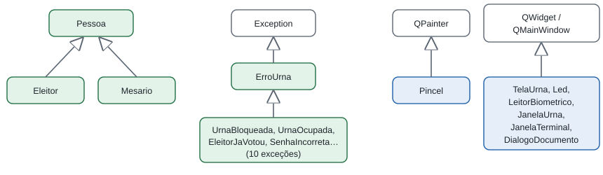

*Herança nas nossas classes (verde/azul) e a partir de classes do Python e do Qt (cinza).*

```python
class Mesario(Pessoa):
    def __init__(self, nome, senha):
        super().__init__(nome)        # Pessoa valida e guarda o nome
        self.__senha = str(senha)     # só o Mesario tem senha

class Pincel(QPainter):            # herda TODOS os métodos de desenho do Qt…
    def escrever(self, rect, conteudo, px, ...):   # …e acrescenta os nossos
        self.setFont(self.fonte(px, negrito))
        self.drawText(rect, alinhar, conteudo)       # método herdado de QPainter
```

**Herança múltipla:** `EleitorNaoEncontrado(ErroUrna, LookupError)` é ao mesmo tempo um erro da urna e um erro de busca do Python.

<a id="polimorfismo" name="polimorfismo"></a>

### 7.7 Polimorfismo e sobrescrita

- **Exceções:** `except ErroUrna as erro:` captura *qualquer* uma das 10 filhas — a mesma linha trata `UrnaOcupada`, `SenhaIncorreta`… e cada uma traz sua própria mensagem.
- **Sobrescrita de métodos do Qt:** `TelaUrna` redefine `paintEvent()`, `mousePressEvent()` e `keyPressEvent()`. O Qt chama sempre o mesmo método; cada widget responde do seu jeito.
- **`__str__`:** `Partido` e `Candidato` definem como aparecem em `print()` / `str()` (ex.: `14 - PAZ`).
- **Ouvintes:** a urna chama `funcao(evento)` sem saber se é a janela da urna ou do terminal.

<a id="composicao" name="composicao"></a>

### 7.8 Composição ("tem um")

Além de herança ("é um"), objetos são montados com outros objetos:

- `Urna` **tem uma** `ImpressoraUrna` e, durante a votação, uma `SessaoVotacao`.
- `Eleicao` tem `Secao`, `Partido`s, `Cargo`s, `Eleitor`es e um `Mesario`.
- `Cargo` tem `Candidato`s; `Candidato` tem um `Partido` e `Vice`s.
- `TerminalMesario` tem uma referência à `Urna` (o "cabo"). `Aplicacao` tem tudo.

<a id="enum-dataclass" name="enum-dataclass"></a>

### 7.9 `Enum` e `@dataclass(frozen=True)`

`Enum` cria um conjunto fechado de valores com nome: `EstadoUrna.VOTANDO` é mais claro e seguro que a string `"votando"` (um erro de digitação vira erro na hora). Usamos `EstadoUrna`, `TipoVoto` e `Modo` (estados do terminal).

`@dataclass(frozen=True)` gera `__init__`, `__repr__` e `__eq__` automaticamente e torna o objeto **imutável**. Usado em `Previa`, `Secao` e `Documento` — dados que, depois de criados, não devem mudar (um BU emitido não pode ser editado).

<a id="excecoes" name="excecoes"></a>

### 7.10 Exceções como regras de negócio

Cada regra violada tem **uma exceção com nome próprio**. O modelo *lança*; a interface *captura* e mostra a mensagem. O programa nunca é derrubado por uma entrada inválida.

```python
# modelo/urna.py — lança
if self.__estado is EstadoUrna.VOTANDO:
    raise UrnaOcupada("Há um eleitor votando.")

# interface/janela_terminal.py — captura
except UrnaOcupada:
    self._mensagem(["URNA OCUPADA", "", "AGUARDE O ELEITOR", "TERMINAR DE VOTAR"])
```

<a id="observer" name="observer"></a>

### 7.11 Padrão Observer (ouvintes)

A urna precisa avisar as duas janelas quando algo muda, mas **não pode depender delas** (o modelo não conhece a interface). Solução: as janelas se cadastram como ouvintes.

```python
# main.py
self.urna.adicionar_ouvinte(self.janela_urna.atualizar)
self.urna.adicionar_ouvinte(self.janela_terminal.atualizar)

# modelo/urna.py
def _notificar(self, evento):
    for funcao in self.__ouvintes:
        funcao(evento)        # "conexao", "estado", "liberada", "tecla", "voto", "fim_eleitor"
```

<a id="regras" name="regras"></a>

## 8. Regras de negócio

> [!NOTE]
> As regras abaixo foram construídas a partir do enunciado do Projeto Integrador, do simulador de referência e do processo eleitoral brasileiro. Veja a origem de cada uma em [15. Fontes utilizadas](#fontes).

### Liberação do eleitor

1. O cabo precisa estar conectado (UrnaDesconectada).
2. A votação precisa estar aberta e a urna livre (VotacaoNaoIniciada, VotacaoEncerrada, UrnaOcupada).
3. O título precisa ser da seção (EleitorNaoEncontrado) e o eleitor não pode ter votado (EleitorJaVotou).
4. **Biometria:** quem tem biometria cadastrada só é liberado com a digital conferida no leitor (BiometriaPendente; a leitura é simulada: um clique aprova). Quem **não tem** é liberado pelo mesário depois de conferir o **documento com foto**.

<a id="como-libera" name="como-libera"></a>

### Como a urna sabe que o eleitor foi liberado

A urna não "enxerga" o mesário. Ela decide se aceita teclas olhando um único dado **privado**: o seu estado, `__estado`. Só o estado `VOTANDO` destrava o teclado, e só existe **um** método que coloca a urna nesse estado: `Urna.habilitar()`, chamado pelo terminal do mesário através do "cabo" (a referência que o `TerminalMesario` guarda para a urna). Como `__estado` não tem *setter*, não há outro caminho para liberar a urna.

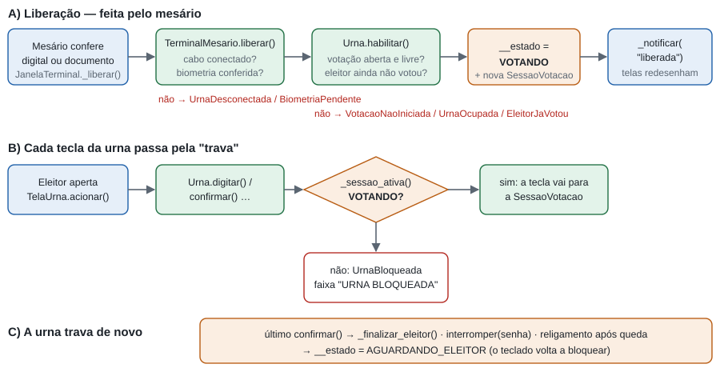

*Verde = modelo; azul = interface; laranja = o estado que funciona como "cadeado" da urna.*

#### O algoritmo, em português estruturado

`resumo do fluxo (pseudocódigo)`

```python
ALGORITMO liberar_eleitor(eleitor)               # terminal do mesário + urna
    SE cabo desconectado ENTÃO ERRO "URNA NÃO CONECTADA"
    SE eleitor tem biometria E digital não conferida ENTÃO ERRO "BIOMETRIA PENDENTE"
    SE votação não aberta OU encerrada ENTÃO ERRO "URNA INDISPONÍVEL"
    SE já existe eleitor votando ENTÃO ERRO "URNA OCUPADA"
    SE eleitor já votou ENTÃO ERRO "ELEITOR JÁ VOTOU"
    sessao <- nova SessaoVotacao(cargos)          # o que ele vai digitar
    estado <- VOTANDO                             # destrava o teclado
    avisar as telas ("liberada")
FIM

ALGORITMO tecla_da_urna(tecla)                   # toda tecla passa por aqui
    SE estado != VOTANDO ENTÃO ERRO UrnaBloqueada  # tela mostra "URNA BLOQUEADA"
    SENÃO repassar a tecla para a sessao
    SE foi o CONFIRMA do último cargo ENTÃO
        marcar comparecimento do eleitor
        estado <- AGUARDANDO_ELEITOR              # trava de novo
FIM
```

#### O mesmo fluxo no código, passo a passo

Trechos copiados do código do projeto. Alguns comentários foram acrescentados aqui para a explicação.

#### 1. A interface do terminal pede a liberação ao modelo

Depois que o mesário conferiu a digital (ou o documento), a janela do terminal não libera nada sozinha: ela chama o modelo e, se alguma regra falhar, só mostra a mensagem no visor.

`interface/janela_terminal.py — JanelaTerminal._liberar (trecho)`

```python
def _liberar(self, digital_conferida):
    try:
        self.terminal.liberar(self._eleitor, digital_conferida)   # pede ao MODELO
    except ErroUrna as erro:                                       # regra não cumprida
        self.leitor.definir_estado("inativo")
        motivo = "URNA NÃO CONECTADA" if isinstance(erro, UrnaDesconectada) else "NÃO LIBERADO"
        self._mensagem([motivo, "", *self._quebrar(str(erro))[:2]])
        return
    self._modo = Modo.VOTANDO        # display: "URNA LIBERADA / ELEITOR VOTANDO..."
```

#### 2. O terminal confere o cabo e a biometria

`modelo/terminal.py — TerminalMesario`

```python
def _urna(self):
    if not self.conectado:                        # sem cabo, nada chega à urna
        raise UrnaDesconectada("A urna não está conectada ao terminal do mesário.")
    return self.__urna

def liberar(self, eleitor, digital_conferida=False):
    urna = self._urna()
    if eleitor.possui_biometria and not digital_conferida:
        raise BiometriaPendente("Confira a digital do eleitor no leitor biométrico.")
    urna.habilitar(eleitor)                       # o "sinal" que vai pelo cabo
```

#### 3. A urna confere as regras e destrava

É aqui que a liberação acontece de fato: depois de todas as conferências, a urna cria a sessão do eleitor e muda o próprio estado para `VOTANDO`. Em seguida avisa as janelas (padrão Observer), e a tela da urna troca de "Aguardando liberação" para "SEU VOTO PARA".

`modelo/urna.py — Urna`

```python
def verificar_disponivel(self):
    if not self.__conectada:
        raise UrnaDesconectada("A urna não está conectada ao terminal do mesário.")
    if self.__estado is EstadoUrna.PREPARADA:
        raise VotacaoNaoIniciada("A votação ainda não foi aberta.")
    if self.__estado is EstadoUrna.ENCERRADA:
        raise VotacaoEncerrada("A votação já foi encerrada.")
    if self.__estado is EstadoUrna.VOTANDO:
        raise UrnaOcupada("Há um eleitor votando.")

def habilitar(self, eleitor):
    self.verificar_disponivel()
    if eleitor.votou:
        raise EleitorJaVotou(f"{eleitor.nome} já votou.")
    self.__sessao = SessaoVotacao(self.__eleicao.cargos)
    self.__eleitor_votando = eleitor              # só para marcar o comparecimento no fim
    self.__estado = EstadoUrna.VOTANDO            # <-- AQUI a urna fica "liberada"
    self._registrar("Eleitor habilitado")         # o log não identifica o eleitor
    self._notificar("liberada")                   # avisa as duas janelas (Observer)
```

#### 4. Toda tecla da urna passa pela trava

Cada tecla começa chamando `_sessao_ativa()`. Se o estado não for `VOTANDO`, a urna lança `UrnaBloqueada` e a tecla é recusada antes de qualquer outra coisa.

`modelo/urna.py — Urna`

```python
def _sessao_ativa(self):
    if self.__estado is not EstadoUrna.VOTANDO:   # a "trava" do teclado
        raise UrnaBloqueada("Aguarde a liberação pelo mesário.")
    return self.__sessao

def digitar(self, digito):                        # votar_branco, corrigir e confirmar
    ok = self._sessao_ativa().digitar(digito)     # começam do mesmo jeito
    self._notificar("tecla")
    return ok
```

#### 5. A tela da urna mostra o bloqueio

`interface/janela_urna.py — TelaUrna.acionar (trecho)`

```python
def acionar(self, nome):
    try:
        if nome.isdigit():
            aceita = self.urna.digitar(nome)
        elif nome == "BRANCO":
            aceita = self.urna.votar_branco()
        elif nome == "CORRIGE":
            aceita = self.urna.corrigir()
        else:
            aceita = self.urna.confirmar() is not None
    except UrnaBloqueada:                         # a urna disse: "ninguém foi liberado"
        self.sons.tocar("erro")
        self.mostrar_aviso("URNA BLOQUEADA", "Aguarde a liberação pelo mesário", "#b0261e",
                           self.BLOQUEIO_SEGUNDOS)
        return
```

#### 6. Ao terminar, a urna trava de novo

Depois do último cargo, a urna marca o comparecimento, descarta a sessão e volta para `AGUARDANDO_ELEITOR`. O mesmo acontece quando o presidente interrompe a votação (`interromper`) ou quando a urna é religada após uma queda de energia.

`modelo/urna.py — Urna`

```python
def _finalizar_eleitor(self):                     # chamado pelo último confirmar()
    self.__eleitor_votando.registrar_comparecimento()
    self.__eleitor_votando = None
    self.__sessao = None
    self.__estado = EstadoUrna.AGUARDANDO_ELEITOR  # <-- trava de novo
    self._registrar("Eleitor concluiu a votação")
    self._notificar("fim_eleitor")                # terminal mostra "VOTO CONCLUÍDO"
```

> [!TIP]
> **Comprovado pelos testes:** `test_teclado_bloqueado_sem_liberacao` (teclas lançam `UrnaBloqueada` sem liberação), `test_sem_cabo_nao_libera` (sem cabo não há liberação) e `test_biometria_e_titulo` (digital pendente e urna ocupada).

### Interpretação do número digitado (`Cargo.interpretar`)

| Digitado (Dep. Federal, 4 dígitos) | Resultado | CONFIRMA aceita? |
|---|---|---|
| `1401` (candidato existe) | NOMINAL — mostra nome, partido e foto | sim |
| `14` (só o partido) | LEGENDA — mostra o partido | sim |
| `140` (incompleto) | mostra o partido, ainda sem tipo | não |
| `1499` (partido existe, candidato não) | LEGENDA — "CANDIDATO INEXISTENTE" | sim |
| `9999` (partido não existe) | NULO — "NÚMERO ERRADO / VOTO NULO" | sim |
| tecla BRANCO com campo vazio | BRANCO — "VOTO EM BRANCO" | sim |

- Cargos **majoritários** não têm legenda: número inexistente é sempre **nulo**.
- **BRANCO** só funciona com o campo vazio; depois do branco, os números são ignorados.
- **CORRIGE** apaga o voto do cargo atual (volta ao início do cargo).
- **Senado:** dois votos; o 2º não aceita o mesmo candidato do 1º ("CANDIDATO JÁ ESCOLHIDO").

### Sigilo do voto

> [!TIP]
> Ao confirmar, o voto vai **direto para os contadores do `Cargo`** (`receber_voto()`, `__legenda`, `__brancos`, `__nulos`). Não existe nenhuma estrutura "eleitor → candidato". O `Eleitor` guarda só `__votou` (SE votou). O log registra "Eleitor habilitado" e "Voto computado: Governador" — sem nome e sem candidato. A **memória** gravada em disco também guarda só contadores e a lista de quem já votou.

### Eleitor que desiste (interrupção pelo presidente)

- `Urna.interromper(senha)` exige a senha do presidente e alguém votando (SenhaIncorreta, OperacaoInvalida).
- **0 votos confirmados** → votação **suspensa**: o eleitor não consta como votante e pode voltar.
- **1 ou mais confirmados** → os confirmados valem, os restantes são computados como **nulos** e o eleitor consta como votante. Assim o BU continua fechando: em cada cargo, *total apurado = comparecimento × votos por eleitor*.

> [!WARNING]
> Regra baseada no procedimento usual da Justiça Eleitoral para eleitor que não conclui o voto. Confira os detalhes no Manual do Mesário oficial.

### Queda de energia (memória da urna)

- A cada evento importante, a urna grava na `MemoriaUrna` (JSON em `memoria/`): estado, cabo, horários, zerésima/BU, log, **quem já votou** e os **contadores** de cada cargo. A gravação é atômica (arquivo temporário + troca), então uma queda no meio não corrompe o arquivo.
- Ao religar, `Urna(eleicao, memoria)` recria tudo: os votos são "reproduzidos" pelos métodos públicos (`receber_voto()`, `registrar()`) — o encapsulamento é preservado.
- Se havia eleitor votando, aplica-se a mesma regra da interrupção (`pendencia_na_queda`).

### Segundo turno

- A urna não tem nada "fixo" sobre cargos: a `SessaoVotacao` monta as etapas a partir de `eleicao.cargos`. Com um único cargo (Presidente), o eleitor confirma uma vez e a votação termina.
- Zerésima e BU usam o `turno` e a `data` do JSON ("2º turno - 25/10/2026") e listam só o cargo em disputa.
- **Os turnos nunca se misturam:** a memória é gravada num arquivo por turno (`urna_Z0001_S0042_T2.json`) e registra o turno; se a memória for de outro turno, `Urna` recusa com `ValueError`. Por isso quem votou no 1º turno pode votar no 2º.

### Abertura e encerramento

- **Abertura** (`Urna.abrir`): exige a senha do presidente (SenhaIncorreta, e a tentativa fica no log) e emite a **zerésima** antes de abrir, provando que todos estão com 0 votos.
- **Encerramento** (`Urna.encerrar`): exige a senha do presidente (SenhaIncorreta, e a tentativa fica no log), não pode haver eleitor votando, e emite o **Boletim de Urna**.

<a id="ref-modelo" name="ref-modelo"></a>

## 9. Referência das classes — `modelo/`

Legenda: `público` `_protegido` `__privado` `@property` `@staticmethod / @classmethod`. Clique numa classe para abrir.

<details open>
<summary><b>Urna</b> — <code>modelo/urna.py</code> — A urna da seção: estados, conexão, liberação, teclas, log, zerésima e BU.</summary>

Só aceita votos quando está **conectada** e há eleitor **habilitado**. Avisa a interface pelos ouvintes.

#### Construtor

- **Urna(eleicao, memoria=None)** — Começa em `PREPARADA`, desconectada, e registra "Urna ligada" no log. Se a `MemoriaUrna` já tem dados, a urna **se recupera** (queda de energia). Atributo de classe `VERSAO_MEMORIA = 2` (a versão 2 passou a registrar o turno).

#### Atributos (todos privados)

| Atributo | Tipo | Por que é privado |
|---|---|---|
| `__eleicao` | Eleicao | A urna pertence a uma eleição fixa. |
| `__impressora` | ImpressoraUrna | Composição: só a urna imprime seus documentos. |
| `__estado` | EstadoUrna | Só muda por `abrir`, `habilitar`, `confirmar` e `encerrar`, que conferem as regras. |
| `__conectada` | bool | Só muda por `conectar`/`desconectar` (registram no log). |
| `__sessao` | SessaoVotacao \| None | Votação em andamento; a interface só lê. |
| `__eleitor_votando` | Eleitor \| None | Só para marcar o comparecimento no fim. **Não tem property**: ninguém de fora descobre quem está votando. |
| `__abertura`, `__encerramento` | datetime | Horários oficiais impressos no BU. |
| `__zeresima`, `__boletim` | Documento | Emitidos uma única vez; não podem ser trocados. |
| `__log` | list | Exposto como **tupla** (cópia imutável). |
| `__ouvintes` | list | Só se adiciona por `adicionar_ouvinte`. |
| `__memoria` | MemoriaUrna \| None | Memória interna; nos testes de regras fica `None` (sem disco). |
| `__recuperada`, `__pendencia_na_queda` | bool, ResultadoInterrupcao | O que aconteceu no religamento. |

#### Properties `@property` (somente leitura)

`eleicao`, `codigo` (código da urna, vem da seção), `estado`, `conectada`, `sessao`, `abertura`, `encerramento`, `zeresima`, `boletim`, `log` (tupla de `(datetime, mensagem)`), `recuperada`, `pendencia_na_queda`.

#### Métodos

- **`pub` adicionar\_ouvinte(funcao)** — Cadastra uma função chamada a cada mudança, recebendo o nome do evento.
- **`_` \_notificar(evento)** — Grava a memória (exceto em `tecla`) e chama todos os ouvintes. Eventos: `conexao`, `estado`, `liberada`, `tecla`, `voto`, `fim_eleitor`, `interrompida`.
- **`_` \_registrar(mensagem)** — Acrescenta `(agora, mensagem)` ao log e grava a memória.
- **`pub` conectar() / desconectar()** — Liga/desliga o "cabo"; registra no log e notifica `conexao`. Repetir não faz nada.
- **`pub` abrir(senha) → Documento** — Confere a senha, emite a zerésima, passa para `AGUARDANDO_ELEITOR` e guarda o horário. ⚠️ *Lança SenhaIncorreta (e registra a tentativa) ou OperacaoInvalida (já aberta).*
- **`pub` encerrar(senha) → Documento** — Confere a senha, encerra e emite o BU. ⚠️ *Lança SenhaIncorreta (e registra a tentativa), UrnaOcupada (eleitor votando), OperacaoInvalida (não está aberta).*
- **`pub` verificar\_disponivel()** — Confere se pode receber um eleitor agora. ⚠️ *Lança UrnaDesconectada, VotacaoNaoIniciada, VotacaoEncerrada ou UrnaOcupada.*
- **`pub` habilitar(eleitor)** — Cria a `SessaoVotacao` e passa para `VOTANDO`. Segunda barreira das regras. ⚠️ *Lança as de verificar\_disponivel e EleitorJaVotou.*
- **`_` \_sessao\_ativa() → SessaoVotacao** — Usado pelas teclas. ⚠️ *Lança UrnaBloqueada se não houver eleitor liberado.*
- **`pub` digitar(digito) / votar\_branco() / corrigir() → bool** — Repassam a tecla para a sessão e notificam `tecla`. Devolvem `False` se a tecla foi ignorada (ex.: BRANCO com número digitado). ⚠️ *Lançam UrnaBloqueada.*
- **`pub` confirmar() → Previa | None** — Confirma o voto do cargo atual (registra no log sem conteúdo). Se era o último, finaliza o eleitor. `None` = não aceito. ⚠️ *Lança UrnaBloqueada.*
- **`_` \_finalizar\_eleitor()** — Marca o comparecimento, descarta a sessão, volta para `AGUARDANDO_ELEITOR` e notifica `fim_eleitor`.
- **`pub` interromper(senha) → ResultadoInterrupcao** — Eleitor desistiu: com 0 votos confirmados suspende; com 1 ou mais, anula os restantes e marca o comparecimento. Notifica `interrompida`. ⚠️ *Lança SenhaIncorreta (e registra a tentativa) ou OperacaoInvalida (ninguém votando).*
- **`__` \_\_salvar() / \_\_fotografia() / \_\_restaurar(dados)** — Memória: monta o dicionário com o estado (só contadores e quem votou) e o grava; no religamento, valida a versão, o código da urna e o **turno** e recria tudo.

</details>

<details>
<summary><b>SessaoVotacao</b> — <code>modelo/urna.py</code> — A votação de UM eleitor: percorre os cargos na ordem e guarda o que está sendo digitado.</summary>

- **SessaoVotacao(cargos, inicio=0)** — Monta as **etapas**: um cargo com 2 vagas (Senado) vira duas etapas. `inicio` &gt; 0 só é usado na recuperação após queda de energia.

| Atributo | Para quê |
|---|---|
| `__etapas` | Lista de `(cargo, ordem_do_voto)`. |
| `__indice` | Etapa atual. |
| `__numero`, `__branco` | O que está digitado agora. |
| `__ja_escolhidos` | Números já confirmados por cargo nesta sessão — só para impedir repetir o senador. Some quando a sessão acaba. |

`@property` `finalizada`, `cargo_atual`, `ordem_voto` (1º/2º voto), `etapa`, `total_etapas`, `numero`, `em_branco`, `previa` (interpreta o número; troca por "CANDIDATO JÁ VOTADO" sem poder confirmar se repetir o senador).

**`ResultadoInterrupcao`** (dataclass imutável): `eleitor_votou`, `confirmados`, `anulados` — devolvido por `Urna.interromper` e guardado em `pendencia_na_queda`.

- **digitar(digito) → bool** — Aceita 1 dígito se não estiver em branco e o número não estiver completo.
- **votar\_branco() → bool** — Só com o campo vazio.
- **corrigir() → bool** — Limpa número e branco do cargo atual.
- **confirmar() → Previa | None** — Se a prévia permitir, chama `cargo.registrar(previa)`, avança e limpa o campo.
- **`@property` votos\_confirmados → int** — Quantas etapas já foram confirmadas.
- **anular\_restantes() → int** — Computa como NULO cada voto que faltava (desistência ou queda de energia).

</details>

<details>
<summary><b>EstadoUrna (Enum)</b> — <code>modelo/urna.py</code> — PREPARADA, AGUARDANDO_ELEITOR, VOTANDO, ENCERRADA.</summary>

Ver o diagrama em [6. Estados da urna](#estados).

</details>

<details>
<summary><b>TerminalMesario</b> — <code>modelo/terminal.py</code> — Identifica o eleitor e libera a urna. Primeira barreira das regras.</summary>

Atributos privados: `__eleicao` (para consultar o caderno) e `__urna` (a ponta do "cabo").

- **`@property` conectado → bool** — Tem urna e ela está conectada.
- **conectar(urna) / desconectar()** — Liga/desliga o cabo (chama `urna.conectar()`/`desconectar()`).
- **`_` \_urna() → Urna** — Devolve a urna conectada. ⚠️ *Lança UrnaDesconectada.*
- **consultar(titulo) → Eleitor** — Busca no caderno da seção. ⚠️ *Lança EleitorNaoEncontrado ou EleitorJaVotou.*
- **verificar\_urna\_pronta()** — Repassa para `urna.verificar_disponivel()`.
- **liberar(eleitor, digital\_conferida=False)** — Libera a urna. Com biometria, exige a digital conferida; sem biometria, o mesário já conferiu o documento. ⚠️ *Lança UrnaDesconectada, BiometriaPendente (+ as da urna).*
- **abrir\_votacao(senha) / encerrar\_votacao(senha) / interromper\_votacao(senha)** — Comandos do presidente da mesa: exigem o cabo conectado e a senha.

</details>

<details>
<summary><b>Secao</b> — <code>modelo/eleicao.py</code> — Agrupa partidos, cargos (na ordem de votação), eleitores e a mesa. Secao guarda UF, município, zona, seção, local e código da urna.</summary>

- **Eleicao(descricao, turno, data, secao, partidos, cargos, eleitores, presidente)** — Monta o dicionário `__eleitores` (título → Eleitor). ⚠️ *Lança ValueError se houver título repetido ou nenhum cargo.*

| Atributo | Property | Detalhe |
|---|---|---|
| `__descricao`, `__turno`, `__data` | `descricao`, `turno`, `data` | Dados fixos da eleição: somente leitura (ver [7.2](#encapsulamento)). |
| `__secao` | `secao` | `Secao` é dataclass imutável. |
| `__partidos` | `partidos` | Devolve **cópia** do dict. |
| `__cargos` | `cargos` | Tupla (imutável), na ordem de votação. |
| `__eleitores` | `eleitores` | Devolve **lista nova** ordenada por nome. |
| `__presidente` | `presidente` | O `Mesario` com a senha. |
| — | `aptos`, `comparecimento` | Calculados na hora. |

- **buscar\_eleitor(titulo) → Eleitor** — ⚠️ *Lança EleitorNaoEncontrado.*

</details>

<details>
<summary><b>TipoVoto</b> — <code>modelo/cargo.py</code> — Um cargo com seus candidatos, a interpretação do número digitado e a contagem dos votos.</summary>

- **Cargo(codigo, nome, digitos, partidos, proporcional=False, votos\_por\_eleitor=1)** — `proporcional=True` permite legenda; `votos_por_eleitor=2` para o Senado. ⚠️ *ValueError se digitos &lt; 2.*

**Atributos privados:** `__codigo`, `__nome`, `__digitos`, `__partidos`, `__proporcional`, `__votos_por_eleitor`, `__candidatos` (número → Candidato), `__legenda` (partido → votos), `__brancos`, `__nulos`. As contagens só mudam por `registrar()`.

`@property` `codigo`, `nome`, `digitos`, `proporcional`, `votos_por_eleitor`, `candidatos` (lista ordenada), `nominais`, `legenda_total`, `brancos`, `nulos`, `validos`, `total`.

- **adicionar\_candidato(candidato)** — ⚠️ *ValueError se o número tiver dígitos errados ou repetir.*
- **buscar(numero) → Candidato | None**
- **candidatos\_do\_partido(numero\_partido) / partidos\_participantes()** — Usados no BU (agrupamento por partido).
- **interpretar(numero) → Previa** — Regras da tabela em [8](#regras).
- **`@staticmethod` previa\_branco() → Previa** — A prévia do voto em branco é igual para qualquer cargo.
- **registrar(previa)** — Soma 1 voto conforme o tipo. Não recebe o eleitor: **sigilo**. ⚠️ *ValueError se a prévia não tiver tipo.*
- **votos\_legenda(numero\_partido) / votos\_partido(numero\_partido) → int** — Legenda; legenda + nominais do partido.

**`Previa`** (dataclass imutável): `tipo` (TipoVoto ou None), `numero`, `candidato`, `partido`, `pode_confirmar`, `aviso` ("NÚMERO ERRADO", "CANDIDATO INEXISTENTE", "CANDIDATO JÁ VOTADO"). **`TipoVoto`** (Enum): NOMINAL, LEGENDA, BRANCO, NULO.

</details>

<details>
<summary><b>Vice</b> — <code>modelo/candidato.py</code> — Candidato com votos privados; Vice/suplente exibido na tela.</summary>

- **Candidato(numero, nome, partido, vices=())** — ⚠️ *ValueError se o número não for numérico, não começar com o número do partido ou o nome estiver vazio.*

Privados: `__numero`, `__nome`, `__partido`, `__vices` (tupla), `__votos`. Properties: `numero`, `nome`, `partido`, `vices`, `votos` — **nenhuma tem setter**.

- **receber\_voto()** — A **única** forma de aumentar `__votos`. Teste real: `c.votos = 1000` → `AttributeError: property 'votos' of 'Candidato' object has no setter`.
- **\_\_str\_\_()** — `"14 Sabrina Duarte (PAZ)"`.

`Vice(titulo, nome)`: atributos públicos (`titulo` = "Vice-Governador", "1º Suplente"…), pois não há regra a proteger.

</details>

<details>
<summary><b>Partido</b> — <code>modelo/partido.py</code> — Número de 2 dígitos, sigla, nome e cor (usada na roupa da "foto").</summary>

- **Partido(numero, sigla, nome, cor="#777777")** — Sigla em maiúsculas. ⚠️ *ValueError se o número não tiver 2 dígitos ou faltar sigla/nome.*
- **\_\_str\_\_()** — `"14 - PAZ"`.

Privados `__numero`, `__sigla`, `__nome`, `__cor` com properties de leitura.

</details>

<details>
<summary><b>Mesario</b> — <code>modelo/pessoas.py</code> — Herança: o nome fica na mãe; título/biometria/voto no Eleitor; senha no Mesario.</summary>

- **Pessoa(nome)** — `__nome` + property `nome`. ⚠️ *ValueError se vazio.*
- **Eleitor(titulo, nome, possui\_biometria=True)** — Atributo de classe `DIGITOS_TITULO = 12`. Privados `__titulo`, `__biometria`, `__votou`. Properties `titulo`, `titulo_formatado`, `possui_biometria`, `votou`. ⚠️ *ValueError se o título não tiver 12 dígitos.*
- **Eleitor.registrar\_comparecimento()** — Marca `__votou = True`. ⚠️ *EleitorJaVotou se já votou.* O eleitor sabe *se* votou, nunca *em quem*.
- **Mesario(nome, senha)** — `__senha` **sem property**: a senha nunca sai da classe.
- **Mesario.autenticar(senha) → bool** — Compara sem revelar a senha guardada.

</details>

<details>
<summary><b>Documento</b> — <code>modelo/boletim.py</code> — Monta a zerésima e o BU (40 colunas) e assina com SHA-256.</summary>

Atributos de classe: `LARGURA = 40`, `DUPLO = "=" * 40`, `TRACO = "-" * 40`.

- **emitir\_zeresima(urna) → Documento** — Cabeçalho + declaração + resultados (todos zerados) + código.
- **emitir\_boletim(urna) → Documento** — Cabeçalho + comparecimento, faltosos, abertura/encerramento + resultados + código.
- **`@staticmethod` calcular\_codigo(linhas) → str** — SHA-256 do texto em hexadecimal maiúsculo.
- **`__` \_\_valor(rotulo, valor, recuo=0)** — Linha `"Rótulo ........ 3"` com exatamente 40 colunas.
- **`__` \_\_centro, \_\_cabecalho, \_\_resultados, \_\_por\_partido, \_\_totais, \_\_assinar** — Partes do documento. Privados: quem usa só precisa de `emitir_*`.

**`Documento`** (dataclass imutável): `tipo`, `linhas`, `codigo`, `zona`, `secao`, `emitido_em`. Properties `texto` e `nome_arquivo` (ex.: `BU_Z0001_S0042_20261112_183656`). Método `verificar()` recalcula o SHA-256 (ignorando as `LINHAS_CODIGO = 5` finais) e devolve `True` se não foi alterado. `para_dict()` e o `@classmethod de_dict(dados)` convertem o documento para a memória da urna.

</details>

<details>
<summary><b>CarregadorEleicao</b> — <code>modelo/carregador.py</code> — Lê dados/eleicao.json e monta todos os objetos.</summary>

- **CarregadorEleicao(caminho).carregar() → Eleicao** — Lê o JSON (UTF-8) e cria Partidos, Cargos, Candidatos, Eleitores, Secao e Mesario.
- **`__` \_\_criar\_partidos(lista) / \_\_criar\_cargo(dados, partidos)** — Etapas internas. ⚠️ *ValueError se um candidato usar partido não cadastrado.*

</details>

<details>
<summary><b>MemoriaUrna</b> — <code>modelo/memoria.py</code> — Memória interna (não volátil) da urna, gravada em JSON — sobrevive à queda de energia.</summary>

Guarda só o que a urna real guarda: contadores de votos, quem já votou, horários, documentos e log. **Nunca** em quem cada eleitor votou. Privado: `__caminho`.

- **MemoriaUrna(caminho)** — Arquivo por seção e turno, por exemplo `memoria/urna_Z0001_S0042_T1.json` (1º turno) e `..._T2.json` (2º turno).
- **existe() / ler() → dict / apagar()** — Consulta, lê ou apaga a memória (`python main.py --nova` apaga).
- **gravar(dados)** — Gravação **atômica**: escreve num `.tmp` e troca pelo arquivo final.

</details>

<details>
<summary><b>ErroUrna</b> — <code>modelo/erros.py</code> — Uma exceção por regra violada; todas herdam de ErroUrna.</summary>

| Exceção | Quando |
|---|---|
| `UrnaDesconectada` | Terminal sem cabo conectado. |
| `UrnaBloqueada` | Tecla na urna sem eleitor liberado. |
| `UrnaOcupada` | Já há eleitor votando. |
| `VotacaoNaoIniciada` / `VotacaoEncerrada` | Fora do horário de votação. |
| `EleitorNaoEncontrado` | Título de outra seção (também é `LookupError`). |
| `EleitorJaVotou` | Tentativa de votar de novo. |
| `BiometriaPendente` | Digital ainda não conferida. |
| `SenhaIncorreta` | Senha do presidente errada. |
| `OperacaoInvalida` | Operação fora de ordem (abrir duas vezes, interromper sem ninguém votando…). |

</details>

<a id="ref-interface" name="ref-interface"></a>

## 10. Referência das classes — `interface/`

<details>
<summary><b>JanelaUrna</b> — <code>interface/janela_urna.py</code> — A urna desenhada à mão com o Pincel; transforma cliques e teclas em chamadas ao modelo.</summary>

Tudo é desenhado num "papel" lógico de `LARGURA × ALTURA = 1200 × 720` e escalado para o tamanho da janela — a urna fica proporcional em qualquer tela. Atributos de classe: `TELA`, `PAINEL` (retângulos), `FIM_SEGUNDOS = 4.0`, `BLOQUEIO_SEGUNDOS = 2.5`, `CORES_TECLAS`.

- **TelaUrna(urna, sons)** — Estado visual: `_teclas`, `_pressionada`, `_piscar`, `_bloqueio_ate`, `_fim_ate`, `_relogio` (QTimer de 450 ms para o cursor/“VOTO NULO” piscarem e o relógio andar).
- **mostrar\_aviso(titulo, subtitulo, cor, segundos) / desligar()** — Faixa colorida sobre a tela (bloqueio, interrupção, energia restabelecida); `desligar` apaga a tela e os LEDs (queda de energia).
- **acionar(nome)** — Repassa a tecla à urna (sem energia, ignora). `UrnaBloqueada` → bipe de erro + faixa vermelha por 2,5 s. Escolhe o som: tecla, confirma ou fim (e mostra FIM por 4 s).
- **\_montar\_teclas() / \_escala() / \_tecla\_em(pos)** — Posição das teclas; fator de escala; converte o clique para coordenadas lógicas.
- **mousePressEvent / mouseReleaseEvent / mouseMoveEvent / keyPressEvent** — Sobrescritas do Qt. Teclado: 0–9, Enter = CONFIRMA, Backspace/Delete/Esc = CORRIGE, B/espaço = BRANCO.
- **paintEvent → \_desenhar\_corpo, \_desenhar\_tela, \_desenhar\_teclas, \_desenhar\_leds** — Desenho por partes.
- **\_tela\_votacao, \_caixas\_numero, \_detalhes, \_fotos, \_linha\_info** — A tela "SEU VOTO PARA": número, nome, partido, vices, fotos, avisos, rodapé CONFIRMA/CORRIGE.
- **\_tela\_espera, \_tela\_fim, \_tela\_mensagem, \_faixa\_bloqueio, \_rodape\_secao** — Demais telas: aguardando, FIM, preparada/desconectada/encerrada, bloqueio, rodapé com seção e relógio.
- **JanelaUrna(urna, sons)** — `QMainWindow` que contém a `TelaUrna`. `atualizar(evento)` redesenha (e mostra a faixa no evento `interrompida`); `desligar()` e `avisar_religamento()` para a queda de energia; `closeEvent` fecha o programa.

</details>

<details>
<summary><b>Modo</b> — <code>interface/janela_terminal.py</code> — Aparelho do mesário (display, teclado, leitor) + painel do presidente, caderno e log.</summary>

Atributos de classe: `COLUNAS_DISPLAY = 24` e `ESTILO` (folha de estilo Qt). `Modo` (Enum) controla o display: TITULO, CONFIRMAR\_ELEITOR, BIOMETRIA, LENDO, VOTANDO, MENSAGEM e SENHA. Atributo de classe `TAMANHO_MAX_SENHA = 8`.

- **JanelaTerminal(terminal, urna, sons, exportador)** — Recebe as dependências prontas (criadas pela `Aplicacao`).
- **\_montar\_aparelho / \_montar\_painel / \_botao** — Constroem os widgets.
- **\_tecla(nome) / keyPressEvent** — Teclado do terminal conforme o `Modo`.
- **\_consultar()** — Chama `terminal.consultar` e `verificar_urna_pronta`; cada exceção vira uma mensagem no display. "Já votou" limpa o título.
- **\_prosseguir() / \_ler\_digital() / \_liberar(digital\_conferida)** — Com biometria: leitor pisca → clique → "LENDO..." 1,3 s → `terminal.liberar`. Sem biometria: o visor pede o documento com foto e CONFIRMA libera direto.
- **\_mensagem(linhas, ms, som) / \_fim\_mensagem(ident)** — Aviso temporário; o `_msg_id` descarta temporizadores antigos. Se alguém está votando, o display volta a "ELEITOR VOTANDO".
- **\_interromper() / \_confirmar\_interrupcao()** — Botão de desistência (só com alguém votando): pede a senha no visor (modo SENHA com ação "interromper"; CORRIGE volta à votação) e mostra "VOTAÇÃO SUSPENSA" ou "VOTAÇÃO INTERROMPIDA".
- **\_simular\_queda() / desligar() / avisar\_religamento()** — Botão ⚡: chama a função `ao_simular_queda` que a `Aplicacao` cadastrou; apaga display, LEDs e controles; depois mostra o resumo recuperado.
- **\_atualizar\_display / \_titulo\_mascarado / \_cortar / \_quebrar** — Montam as 4 linhas de 24 colunas do LCD.
- **\_alternar\_cabo / \_ver\_documentos / \_exibir** — Painel do presidente: cabo e documentos emitidos.
- **\_abrir() / \_encerrar() / \_pedir\_senha(acao) / \_tecla\_senha(nome) / \_confirmar\_senha()** — Abertura e encerramento **pelo visor**. `_abrir` (urna preparada e cabo conectado) e `_encerrar` (urna livre) chamam `_pedir_senha("abrir"|"encerrar")`, que põe o terminal no modo SENHA; `_tecla_senha` recebe os dígitos (mascarados com \*), CORRIGE sai; `_confirmar_senha` chama `terminal.abrir_votacao(senha)` ou `encerrar_votacao(senha)`, trata `SenhaIncorreta` com aviso no display e **apaga a senha da memória** logo após o uso.
- **atualizar(evento)** — Ouvinte da urna: LEDs, botões, estatísticas, caderno, log, display; trata `fim_eleitor` e o encerramento.
- **\_atualizar\_caderno / \_usar\_caderno / \_atualizar\_log** — Tabela de eleitores (✔ Votou, Votando…, Aguardando) e lista de eventos.

</details>

<details>
<summary><b>Led</b> — <code>interface/janela_terminal.py</code> — Widgets desenhados: leitor de digital simulado e luz indicadora.</summary>

- **LeitorBiometrico** — Sinal Qt `tocado` (atributo de classe `Signal()`). Estados: inativo, aguardando (pulsa), lendo (linha de varredura), ok. `definir_estado()`, `_animar()` (40 ms), `mousePressEvent` emite `tocado`.
- **Led(rotulo, cor)** — `definir(ligado)` acende/apaga; `paintEvent` desenha o brilho.

</details>

<details>
<summary><b>Pincel</b> — <code>interface/desenho.py</code> — QPainter com métodos extras: escrever, escrever_partes, foto.</summary>

- **Pincel(dispositivo)** — Chama `super().__init__` e liga o antisserrilhado.
- **`@classmethod` fonte(px, negrito, mono) / largura(conteudo, px, negrito)** — Fonte em pixels (escala com o desenho); largura do texto.
- **escrever(rect, conteudo, px, negrito, cor, alinhar) / escrever\_partes(x, y, partes, px)** — Texto simples ou com trechos em negrito ("**CONFIRMA** para CONFIRMAR…").
- **foto(rect, nome, cor\_partido)** — Retrato ilustrado: pele e cabelo variam pelo nome; roupa na cor do partido. Dispensa imagens.

</details>

<details>
<summary><b>ExportadorDocumento</b> — <code>interface/dialogo_documento.py · exportar.py</code> — Mostra o documento como bobina e salva em .txt/.pdf.</summary>

- **DialogoDocumento(documento, caminhos, pai)** — Papel com fonte monoespaçada, aviso "✔ código de verificação confere" (chama `documento.verificar()`), botões Abrir PDF / Abrir pasta.
- **ExportadorDocumento(pasta)** — Atributos de classe `LARGURA_PAPEL_MM = 80`, `ENTRELINHA_MM`, `MARGEM_MM`. `caminhos(doc)`, `salvar(doc)` e o privado `__gerar_pdf` (QPdfWriter, 300 dpi, altura calculada pelo nº de linhas).

</details>

<details>
<summary><b>Sons</b> — <code>interface/sons.py</code> — Bipes gerados por código (sem arquivos de áudio).</summary>

- **Sons(ativo=True)** — Gera os .wav na pasta temporária e carrega com `QSoundEffect`. Sem QtMultimedia, funciona em silêncio.
- **tocar(nome)** — `tecla`, `confirma`, `fim`, `erro`, `liberado`. `@property` `disponiveis`.
- **`__` \_\_gerar\_wav(caminho, sequencia, volume)** — Sintetiza senoides com rampa de 5 ms (atributos de classe `TAXA` e `SEQUENCIAS`).

</details>

<details>
<summary><b>Creditos</b> — <code>interface/creditos.py</code> — Mensagem de desenvolvimento exibida no rodapé das duas janelas.</summary>

Atributos de classe `ALUNO`, `PROFESSOR`, `MODULO`, `INSTITUICAO` e `ANO`: os créditos ficam em **um só lugar**, e as duas janelas usam o mesmo texto.

- **`@classmethod` texto() → str** — "Desenvolvido por … com os conceitos aprendidos nas aulas do Prof. Esp. Ibukun Didier • Programação em Python — ITEAM 2026".
- **`@classmethod` instalar\_rodape(janela, escuro=False) → QLabel** — Põe o texto na barra de status (rodapé) de uma `QMainWindow`, numa linha só (tema escuro na urna, claro no terminal). Não precisa criar um objeto: é `@classmethod` porque só usa os atributos da classe.

</details>

<details>
<summary><b>Aplicacao</b> — <code>main.py</code> — Ponto de entrada: cria o modelo, as janelas e liga os ouvintes.</summary>

- **Aplicacao(argumentos)** — Cria `QApplication` (privado `__qt`), carrega a eleição, cria `Urna`, `TerminalMesario`, `Sons`, `ExportadorDocumento` e as duas janelas; cadastra as janelas como ouvintes.
- **executar() → int** — Posiciona, mostra as janelas e roda o laço de eventos do Qt.
- **`__` \_\_escolher\_eleicao(argumentos)** — `--eleicao arquivo.json` escolhe outra eleição (ex.: 2º turno); o padrão é `dados/eleicao.json`.
- **`__` \_\_preparar\_memoria(argumentos)** — Com votação gravada, pergunta se continua ou começa nova; `--nova` apaga direto.
- **`__` \_\_montar()** — Cria eleição, `Urna(eleicao, memoria)`, terminal (reconecta o cabo se estava ligado), janelas e ouvintes.
- **`__` \_\_simular\_queda() / \_\_religar()** — Desliga as janelas, espera `SEGUNDOS_SEM_ENERGIA = 3` e recria tudo do zero com `__montar()`, mantendo a posição das janelas.
- **`__` \_\_posicionar()** — Terminal à esquerda, urna à direita, cabendo na tela.

```python
if __name__ == "__main__":
    sys.exit(Aplicacao(sys.argv).executar())
```

</details>

<a id="json" name="json"></a>

## 11. Arquivo `dados/eleicao.json`

Todos os dados da eleição ficam fora do código. Para trocar candidatos, eleitores ou a senha, basta editar o JSON. O 2º turno é só **outro arquivo** (`dados/eleicao_2turno.json`) com `"turno": 2`, a data do 2º turno e um único cargo — nenhuma linha de código muda:

```json
{
  "eleicao": { "descricao": "Eleições Gerais 2026 (simulação)", "turno": 2, "data": "25/10/2026" },
  "cargos": [
    { "codigo": "PR", "nome": "Presidente", "digitos": 2,
      "candidatos": [ { "numero": "14", ... }, { "numero": "27", ... } ] }
  ],
  ...  seção, partidos, mesa e eleitores iguais ao 1º turno
}
```

```json
{
  "eleicao": { "descricao": "Eleições Gerais 2026 (simulação)", "turno": 1, "data": "04/10/2026" },
  "secao":   { "uf": "RR", "municipio": "Boa Vista", "zona": "0001", "secao": "0042",
               "local": "...", "codigo_urna": "2026.0001.0042" },
  "mesa":    { "presidente": "Presidente da Mesa", "senha": "1234" },
  "partidos": [ { "numero": "14", "sigla": "PAZ", "nome": "...", "cor": "#2e7d32" } ],
  "cargos": [
    { "codigo": "DF", "nome": "Deputado Federal", "digitos": 4, "proporcional": true,
      "candidatos": [ { "numero": "1401", "nome": "Ana Beatriz Moura" } ] },
    { "codigo": "SE", "nome": "Senador", "digitos": 3, "votos_por_eleitor": 2,
      "candidatos": [ { "numero": "141", "nome": "Neusa Barreto",
                       "vices": [ { "titulo": "1º Suplente", "nome": "Osmar Teles" } ] } ] }
  ],
  "eleitores": [ { "titulo": "000123450101", "nome": "João Pereira da Silva", "biometria": true } ]
}
```

- A **ordem** de `"cargos"` é a ordem de votação na urna.
- O número do candidato deve **começar com o número do partido** e ter os dígitos do cargo — senão o carregamento falha com mensagem clara.
- `"biometria": false` = o eleitor é liberado pela conferência do **documento com foto**.

<a id="boletim" name="boletim"></a>

## 12. Zerésima e Boletim de Urna

#### Zerésima

Emitida na **abertura**. Lista todos os candidatos com **0 votos**, provando que a urna começou vazia.

#### Boletim de Urna (BU)

Emitido no **encerramento**: aptos, comparecimento, faltosos, horários, votos por partido/candidato, legenda, brancos, nulos e total apurado de cada cargo.

```text
========================================
            BOLETIM DE URNA
 *** SIMULAÇÃO - SEM VALOR OFICIAL ***
========================================
Eleitores aptos ...................... 8
Comparecimento ....................... 2
...
               GOVERNADOR
----------------------------------------
14 SABRINA DUARTE (PAZ) .............. 1
27 UBIRAJARA MELO (MUC) .............. 1
----------------------------------------
Votos nominais ....................... 2
Total apurado ........................ 2
========================================
Código de verificação (SHA-256):
F75F 85DB E0A1 B187 6896 4C98 33EC 3A48
0370 E873 5D9A 9893 2903 88EC 0D83 D151
```

### Código de verificação (SHA-256)

O SHA-256 é uma "impressão digital" do texto: qualquer alteração — mesmo de um único voto — gera um código completamente diferente. `Documento.verificar()` recalcula o código e compara; a janela do BU mostra "✔ código de verificação confere". Os arquivos ficam em `boletins/` como `.txt` e como `.pdf` no formato de bobina de 80 mm.

<a id="testes" name="testes"></a>

## 13. Testes automáticos

`testes/test_modelo.py` e `testes/test_memoria.py` usam `unittest` e testa só o modelo (sem abrir janelas) — possível graças à separação em camadas.

| Teste | O que garante |
|---|---|
| `test_sem_cabo_nao_libera` | Sem cabo não abre a votação nem libera eleitor. |
| `test_teclado_bloqueado_sem_liberacao` | Teclas da urna lançam `UrnaBloqueada` sem liberação. |
| `test_abertura_exige_senha` | Senha errada não abre a votação, não emite zerésima e fica no log. |
| `test_votacao_nao_iniciada` | Não libera antes da zerésima. |
| `test_biometria_e_titulo` | Título inexistente, digital pendente e urna ocupada. |
| `test_sem_biometria_vota_com_documento` | Eleitor sem biometria é liberado sem a digital e vota. |
| `test_interromper_sem_voto_confirmado_suspende` | Desistência sem voto: suspensa, eleitor pode voltar; senha errada recusada. |
| `test_interromper_com_votos_anula_restantes` | Confirmados valem, restantes viram nulos, BU continua fechando. |
| `test_caderno_e_votos_sobrevivem_a_queda` | *test\_memoria*: após a queda, caderno, votos, cabo, zerésima e log são recuperados e a votação continua até o BU. |
| `test_queda_com_eleitor_no_meio_da_votacao` | *test\_memoria*: eleitor com 2 votos confirmados na queda → 4 nulos e consta como votou. |
| `test_queda_antes_do_primeiro_voto_suspende` | *test\_memoria*: sem voto confirmado na queda → pode votar de novo. |
| `test_urna_encerrada_continua_encerrada` | *test\_memoria*: BU recuperado e com código válido. |
| `test_memoria_do_1o_turno_nao_vaza_para_o_2o` | *test\_memoria*: memória do 1º turno é recusada no 2º; quem votou no 1º pode votar no 2º. |
| `test_memoria_nao_liga_eleitor_ao_voto` | *test\_memoria*: a memória só tem contadores (sigilo). |
| `test_fluxo_completo_e_boletim` | Dois eleitores votam (nominal, legenda, branco, nulo, Senado 2 votos); contagens, senha, BU com 40 colunas e código válido. |
| `test_regras_do_teclado` | BRANCO só com campo vazio; CONFIRMA não aceita número incompleto. |
| `test_senado_nao_aceita_mesmo_candidato` | 2º voto ao Senado não repete o 1º. |
| `test_segundo_turno_so_presidente` | 2º turno com só Presidente: um CONFIRMA já encerra o eleitor; BU com "2º turno" e sem outros cargos. |
| `test_interpretacao` | Tabela de nominal/legenda/nulo de `Cargo.interpretar`. |

```bash
$ python -m unittest discover -s testes -t .
...................
Ran 19 tests
OK
```

<a id="explicacoes" name="explicacoes"></a>

## 14. Explicações sobre as decisões do projeto

Esta seção resume, com as palavras do autor, o porquê das principais escolhas de implementação.

#### Diferença entre `_turno` e `__turno`

`_turno` é só um aviso de "uso interno": o Python não muda nada. `__turno` ativa o *name mangling*: o atributo passa a se chamar `_Eleicao__turno`, por isso `eleicao.__turno` gera `AttributeError` e as subclasses não colidem com o mesmo nome. Usamos `__` nos dados que representam as regras da eleição.

#### Para que serve `__`, se dá para acessar `_Eleicao__turno`

O objetivo é evitar **acidentes**, não ataques. O `__` deixa explícito o que é interno e impede que um trecho de código altere uma regra sem perceber; quem escreve `_Eleicao__turno` sabe que está quebrando o encapsulamento.

#### Por que `@property` em vez de métodos `get_...()`

É a forma "pythônica": quem usa a classe escreve `eleicao.turno` como se fosse um atributo, mas a classe controla o acesso — sem *setter*, o valor é somente leitura — e pode calcular o resultado na hora, como em `Cargo.total`.

#### Como o sigilo do voto é garantido

O voto confirmado vai direto para os contadores do `Cargo`; não existe nenhuma ligação eleitor → candidato. O eleitor guarda apenas `votou`, o log não registra nome nem candidato, a `SessaoVotacao` é descartada no fim e a memória gravada em disco contém só contadores e a lista de quem já votou.

#### Comportamento quando o cabo é desconectado

O eleitor que já está votando termina normalmente (como na urna real, que funciona sozinha), mas nenhum novo eleitor é liberado até reconectar (`UrnaDesconectada`), e a urna mostra o aviso "TERMINAL DO MESÁRIO DESCONECTADO".

#### Uma responsabilidade por classe (Aula 10)

Uma classe com muitas responsabilidades é difícil de manter: se a `Urna` também lesse o teclado e desenhasse a tela, mudar a interface obrigaria a mexer nas regras da eleição. Por isso: `Urna` = regras, `ImpressoraUrna` = documentos, `MemoriaUrna` = gravação, `TelaUrna` = desenho, `ExportadorDocumento` = arquivos.

#### Biometria: o que é simulado e o que é regra

A **leitura** da digital é simulada (um clique aprova). A **regra** é real no código: com biometria cadastrada a liberação exige a digital conferida (`BiometriaPendente`); sem biometria, o mesário confere o documento com foto. As duas situações são garantidas pelo modelo e pelos testes.

#### Eleitor que desiste no meio da votação

O presidente da mesa usa *Interromper votação do eleitor* com a senha. Sem nenhum voto confirmado, a votação é suspensa e o eleitor pode voltar; com pelo menos um, os votos confirmados valem e os restantes são computados como nulos (`Urna.interromper`). Assim o boletim continua fechando: em cada cargo, total apurado = comparecimento × votos por eleitor.

#### Queda de energia sem perda de votos

A `MemoriaUrna` grava o estado a cada evento, de forma atômica. Ao religar, `Urna(eleicao, memoria)` recupera votos, caderno, log e documentos — o que pode ser demonstrado com o botão ⚡ e está comprovado em `testes/test_memoria.py`.

#### Segundo turno sem alterar o código

Como os cargos vêm do JSON e a `SessaoVotacao` é montada a partir deles, o 2º turno é só outro arquivo de dados. O único cuidado foi na memória da urna: ela passou a registrar o turno e a usar um arquivo por turno, para que os votos e o caderno do 1º turno nunca apareçam no 2º — defeito encontrado ao testar o 2º turno e coberto por teste.

#### Onde estão herança e polimorfismo

**Herança:** `Pessoa → Eleitor/Mesario`, `ErroUrna → 10 exceções`, `Pincel(QPainter)` e as janelas do Qt. **Polimorfismo:** `except ErroUrna` trata qualquer exceção filha; `paintEvent` e `keyPressEvent` são sobrescritos; `__str__` define como cada objeto aparece em `print()`.

<a id="fontes" name="fontes"></a>

## 15. Fontes utilizadas

As regras de negócio do simulador foram construídas a partir das fontes abaixo. Onde a regra é uma simplificação didática ou não pôde ser conferida no documento oficial, isso está indicado.

| Fonte | O que foi usado no projeto | Observação |
|---|---|---|
| **Slides do curso Programação em Python** — Aulas 01 a 10. Esp. Ibukun Didier. Capacitação em Desenvolvimento Full Stack, ITEAM, Boa Vista/RR, 2026. | Enunciado do Projeto Integrador (Aula 06): candidatos, eleitores, voto único e sigiloso, entradas inválidas tratadas com `try/except`, lógica em classes com encapsulamento, apuração com votos válidos, percentual e vencedor. Conceitos de classes, objetos, `__init__`, `self`, herança, encapsulamento, `@property` e polimorfismo (Aulas 08 e 09). Rubrica de revisão e roteiro de apresentação (Aula 10). | Fonte principal dos requisitos e dos conceitos. |
| **Minha Colinha — simulador de votação**. [minhacolinha.com/simulador](https://minhacolinha.com/simulador) e [minhacolinha.com/colinha-eleitoral](https://minhacolinha.com/colinha-eleitoral). | Ordem dos cargos nas Eleições Gerais de 2026 e quantidade de dígitos (Deputado Federal 4, Deputado Estadual 5, Senador 3 com dois votos independentes, Governador 2, Presidente 2); tecla BRANCO só com o campo vazio; CORRIGE reinicia o voto; CONFIRMA não permite voltar; exibição de foto, vice e suplentes; não repetir o mesmo senador. | Consultado em 12/11/2026. Referência visual e de comportamento da urna. |
| **Manual do Mesário — Eleições 2022**. Justiça Eleitoral / Tribunal Superior Eleitoral (TSE). [manual-do-mesario-2022-digital.pdf](https://www.justicaeleitoral.jus.br/eleicoes/mesario/assets/arquivos/manual-do-mesario-2022-digital.pdf). | Referência para os procedimentos da seção eleitoral: zerésima, identificação do eleitor, biometria ou documento com foto, liberação pelo terminal do mesário, eleitor que não conclui o voto, encerramento e boletim de urna. | O site recusou o acesso automatizado durante o desenvolvimento. As regras de **eleitor sem biometria** e de **desistência** seguiram o procedimento usual conhecido e **devem ser conferidas** no manual. |
| **Conhecimento geral do processo eleitoral brasileiro**. | Voto nominal, de legenda (cargos proporcionais), branco e nulo; terminal do mesário ligado à urna por cabo; zerésima antes da votação; boletim de urna no encerramento; log de eventos; sigilo do voto; memória interna que preserva os votos. | Simplificado para fins didáticos. Datas usadas: 1º turno em 04/10/2026 e 2º turno em 25/10/2026. |
| **Documentação oficial das ferramentas**: Python 3 ([docs.python.org/3](https://docs.python.org/3/)) e Qt for Python / PySide6 ([doc.qt.io/qtforpython-6](https://doc.qt.io/qtforpython-6/)). | Linguagem, biblioteca padrão (`json`, `hashlib`, `dataclasses`, `enum`, `unittest`) e componentes gráficos (janelas, `QPainter`, sons, geração de PDF). | Referência técnica. |

### Decisões próprias e simplificações em relação ao processo real

- **Senha do presidente da mesa** digitada no visor do terminal para abrir, encerrar e interromper a votação.
- **Leitura biométrica simulada**: um clique no leitor sempre aprova a digital (não há falha de leitura).
- **Boletim de Urna** emitido em uma via digital (`.txt` e `.pdf`) com código de verificação SHA-256, sem as vias impressas, assinaturas e QR Code do processo real.
- **Memória da urna** representada por um arquivo JSON.
- **Sem horários fixos** de abertura e encerramento, justificativa de ausência, recursos de acessibilidade ou urna de contingência.
- **Dados fictícios**: partidos, candidatos e eleitores foram criados para a simulação; documentos sem valor oficial.

**Desenvolvido por Ivonielson F. com os conceitos aprendidos nas aulas do Prof. Esp. Ibukun Didier** • Programação em Python — Capacitação em Desenvolvimento Full Stack • ITEAM 2026.<br>
Simulador de Urna Eletrônica — Projeto Integrador. Simulação educacional: partidos, candidatos e eleitores fictícios; documentos sem valor oficial.
